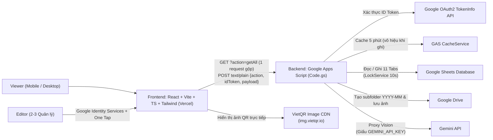

# SPEC.md — Hệ Thống Quản Lý Lịch Cầu Lông & Chia Tiền Ăn Nhậu

> **Vai trò tài liệu:** Nguồn chân lý duy nhất (Single Source of Truth) cho kiến trúc, phân quyền, nghiệp vụ tính tiền tách biệt Cầu lông / Ăn nhậu, cơ sở dữ liệu Google Sheets (11 tabs), hợp đồng API (REST over Google Apps Script) và giao diện Mobile-first của dự án.

---

## 1. Tổng quan & Mục tiêu dự án

### 1.1. Bối cảnh & Phạm vi sản phẩm
Dự án xây dựng một Web Application tối ưu cho thiết bị di động (**Mobile-first**) giúp câu lạc bộ cầu lông và hội ăn nhậu quản lý minh bạch, tách biệt rõ ràng hai dòng tiền:
- **Cầu lông (`BADMINTON`):**
  - Lập lịch tháng (`Schedule`) từ đầu tháng: tích ngày đánh, khung giờ, số sân, danh sách người chơi chính dự kiến; hỗ trợ điền nhanh khi tạo buổi thực tế.
  - Tính chi tiết chi phí từng buổi: `Tiền sân` (hỗ trợ nhiều dòng sân + **Sân thêm giờ**) + `Tiền cầu` (`số quả * đơn giá`) + `Chi phí khác`, cho phép tự động tính hoặc bật ghi đè nhập tay.
  - **Hóa đơn Cầu lông theo tháng (`Monthly_Bills` & `Monthly_Dues`):** Đầu tháng Thủ quỹ ước tính chi phí tháng (gợi ý từ lịch tháng) trừ đi phần dư/thâm hụt kỳ trước chuyển sang (`carry_in`), rồi chia đều cho thành viên chính (`MAIN`) tham gia tháng đó (`ceil` theo `rounding_unit = 1000`). Cuối tháng chốt chi phí thực tế (`actual_cost`) và cộng phần thu vãng lai (`guest_income`) để ra số dư chuyển kỳ sau (`carry_out`).
  - Khách vãng lai (`GUEST`) đóng phí theo buổi (`guest_fee`) trực tiếp cho Thủ quỹ (`treasurer_member_id`); **không tạo chuyển khoản chéo giữa các thành viên chính**.
- **Ăn nhậu (`DRINKING`):**
  - Hỗ trợ cả ăn ngoài quán (`RESTAURANT`) lẫn tụ tập ở nhà (`HOME`) có góp món (`Session_Items`: `BILL` | `ITEM`).
  - Tổng chi phí bàn nhậu bằng tổng các khoản `BILL` và `ITEM` (hoặc tổng hóa đơn nhập tay/AI); chia đều cho những người tham gia; tính `net_amount = per_person - contributed_amount` cho từng người (`> 0` là phải trả thêm, `< 0` là được nhận lại).
  - Thuật toán cấn trừ nợ vòng tròn (**Debt Simplification**) **chỉ chạy nội bộ trong nhóm Ăn nhậu**, không bao giờ trộn lẫn với công nợ Cầu lông.
- **Tích hợp AI (Gemini):** Bóc tách hóa đơn từ ảnh chụp (lưu ảnh trên Google Drive theo thư mục tháng `YYYY-MM`). Điểm danh sử dụng tick tay trực tiếp + tìm kiếm + thêm nhanh vãng lai (đã lược bỏ giọng nói).
- **Hiệu năng & Offline-tolerant:** API gộp `getAll` + GAS `CacheService` (5 phút, tự làm mới khi ghi) + cache `localStorage` Stale-While-Revalidate + lưu phiên đăng nhập Editor trong `localStorage` với làm mới token thầm lặng (Google One Tap).

### 1.2. Nguyên tắc thiết kế cốt lõi
1. **Viewer Zero-Friction:** Thành viên thường mở link trên điện thoại là xem được ngay tổng quan, lịch cầu lông, lịch sử buổi chơi, công nợ tách riêng Cầu lông / Ăn nhậu, hóa đơn tháng và quét mã **VietQR** — **không cần đăng nhập**.
2. **Tách biệt tuyệt đối Cầu lông & Ăn nhậu:** Công nợ Cầu lông (`Monthly_Dues` và phí `GUEST`) luôn chuyển thẳng cho Thủ quỹ (`treasurer_member_id`). Công nợ Ăn nhậu chỉ đối soát chéo giữa các thành viên có phát sinh ăn nhậu.
3. **Google Sheets làm Database minh bạch (11 Tabs):** Tự động format plain text (`@`) cho các cột ID, ngày, số điện thoại, `bank_bin`, `account_no` để tránh Google Sheets mất số `0` đầu hoặc biến đổi thành số khoa học.
4. **GAS làm Backend & Security Proxy:** Toàn bộ logic ghi dữ liệu (`LockService`), xác thực Google ID Token, lưu ảnh Drive và gọi Gemini API đều đi qua Google Apps Script (`Code.gs`).

---

## 2. Kiến trúc hệ thống & Cấu trúc thư mục

### 2.1. Sơ đồ kiến trúc tổng thể



### 2.2. Cấu trúc thư mục dự án

```text
caulong-nhau/
├── SPEC.md                          # Tài liệu đặc tả nguồn chân lý duy nhất
├── README.md                        # Hướng dẫn triển khai từ A-Z
├── frontend/                        # Web App React + Vite + TypeScript + Tailwind (Deploy Vercel)
│   ├── public/                      # Static assets, icons, manifest.json
│   └── src/
│       ├── components/              # Layout, VietQRModal, ReauthModal, EditorLoginButton, CardSkeleton...
│       ├── contexts/                # AuthContext (localStorage + One Tap), ToastContext
│       ├── hooks/                   # useClubData (getAll + SWR localStorage)
│       ├── pages/                   # DashboardPage, CalendarPage, DebtsAndSessionsPage, MonthlyBadmintonPage, CreateSessionPage, SettingsPage
│       ├── services/                # api.ts, mockData.ts, imageCompression.ts
│       ├── types/                   # index.ts (khớp 100% Schema 11 tabs & API Contract)
│       └── utils/                   # badmintonCost.ts, monthlyBill.ts, drinkingSplit.ts, schedule.ts, debtSimplifier.ts, vietqr.ts, dateFilters.ts
└── gas-backend/                     # Google Apps Script REST API
    ├── Code.gs                      # Entrypoint doGet / doPost + CacheService wrapper
    ├── AuthService.gs               # Verify Google ID Token + kiểm tra tab Editors
    ├── SheetService.gs              # Schema 11 tabs, CRUD, nghiệp vụ Cầu lông / Ăn nhậu / Lịch / Tháng cầu
    ├── DriveService.gs              # Upload ảnh hóa đơn vào subfolder YYYY-MM
    ├── GeminiService.gs             # Bóc tách ảnh hóa đơn (parseBillImage)
    └── DEPLOY_GAS.md                # Hướng dẫn deploy GAS chi tiết
```

### 2.3. Biến môi trường & Cấu hình

#### Frontend (`/frontend/.env`)
| Biến | Bắt buộc | Mô tả |
| :--- | :--- | :--- |
| `VITE_GAS_API_URL` | Có | URL Web App deployment của Google Apps Script (`https://script.google.com/macros/s/.../exec`) |
| `VITE_GOOGLE_CLIENT_ID` | Có | OAuth 2.0 Client ID (Web Application) dùng cho Google Identity Services |
| `VITE_USE_MOCK` | Không | `true` để chạy local bằng mock data, `false` khi chạy thật |

#### GAS Backend (`PropertiesService.getScriptProperties()`)
| Property Key | Bắt buộc | Mô tả |
| :--- | :--- | :--- |
| `SPREADSHEET_ID` | Có (nếu standalone) | ID của Google Sheet chứa 11 tabs dữ liệu (không bắt buộc nếu GAS gắn trực tiếp với Sheet) |
| `ROOT_DRIVE_FOLDER_ID` | Có | ID thư mục gốc trên Google Drive dùng để tự động tạo subfolder `YYYY-MM` |
| `GEMINI_API_KEY` | Có | API Key của Google Gemini (chỉ lưu ở Script Properties, không lộ ra Frontend) |
| `GEMINI_MODEL` | Không | Tên model Gemini mặc định (VD: `gemini-2.5-flash`) |
| `GOOGLE_CLIENT_ID` | Có | Trùng với `VITE_GOOGLE_CLIENT_ID`, dùng xác minh trường `aud` của ID Token |

---

## 3. Phân quyền & Bảo mật (AuthN / AuthZ)

### 3.1. Hai vai trò người dùng
| Vai trò | Điều kiện truy cập | Quyền hạn |
| :--- | :--- | :--- |
| **Viewer** | Không cần đăng nhập | Xem `Tổng quan`, `Lịch` cầu lông & ăn nhậu, `Công nợ` tách riêng Cầu lông / Ăn nhậu + `Lịch sử buổi`, `Tháng cầu` (hóa đơn tháng & thống kê vãng lai), mở **VietQR**. |
| **Editor** | Đăng nhập Google + email nằm trong tab `Editors` (`is_active = TRUE`) | Toàn bộ quyền Viewer + Tạo/Sửa/Xóa buổi (`BADMINTON`, `DRINKING`), Chụp ảnh hóa đơn AI, Lập/Sửa lịch tháng (`Schedule`), Phát hành/Chốt hóa đơn tháng (`Monthly_Bills`), Xác nhận thanh toán, Quản lý `Members` và `Settings`. |

> **Phân cấp nội bộ trong tab `Editors`:**
> - `EDITOR`: Toàn quyền nghiệp vụ (buổi chơi, lịch, hóa đơn tháng, công nợ, thành viên, cài đặt).
> - `ADMIN`: Toàn quyền `EDITOR` + quản lý danh sách `Editors` (`manageEditors`).

### 3.2. Luồng xác thực Google ID Token & Lưu phiên `localStorage`
1. Frontend lưu phiên tại `localStorage` (`cln_editor_session_v2`, `cln_editor_profile_v2`) để người dùng đóng/mở lại trình duyệt trên điện thoại vẫn giữ trạng thái đăng nhập nhanh.
2. Khi token sắp hết hạn hoặc API trả `UNAUTHORIZED`, Frontend tự thử làm mới thầm lặng qua Google Identity Services (`auto_select: true` / One Tap). Nếu không thể làm mới thầm lặng, mở `ReauthModal` để đăng nhập lại 1 chạm mà **không xóa dữ liệu form đang nhập**.
3. Backend `AuthService.gs` kiểm tra `idToken` qua `tokeninfo`, xác minh `aud`, `email_verified`, `exp`, đối chiếu `email` trong tab `Editors` (`is_active = TRUE`), và bọc mọi thao tác ghi trong `LockService.getScriptLock().waitLock(10000)`.
4. Sau mỗi thao tác ghi thành công, Backend gọi `bumpCacheVersion_()` để vô hiệu cache `getAll` ngay lập tức.

---

## 4. Quy tắc nghiệp vụ chi tiết (Business Logic)

### 4.1. Luồng Cầu lông (`BADMINTON`)

#### A. Chi phí từng buổi Cầu lông (Sân + Sân thêm giờ + Cầu + Chi phí khác)
- **Tiền sân (`court_amount`):** Tổng hợp từ mảng `costDetail.courtLines[]` gồm các dòng `{ label, courts, hours, pricePerHour, amount, isExtra }`. Hỗ trợ dòng sân mặc định và thêm nhiều dòng **Sân thêm giờ** (`isExtra = true`, VD: tăng cường 1 sân thêm 1 giờ cho buổi đông vãng lai).
- **Tiền cầu (`shuttle_amount`):** `shuttle_qty * costDetail.shuttlePrice`.
- **Chi phí khác (`other_amount`):** Nước uống, phụ phí... (từ ô *"Số lượng cầu / chi phí khác"* hoặc ghi chú).
- **Tổng tiền buổi (`total_amount`):** `court_amount + shuttle_amount + other_amount`.
- Cả 3 phần (`courtOverride`, `shuttleOverride`, `totalOverride`) đều hỗ trợ chuyển giữa **tự động tính** và **tự điền tay**.
- Khi ghi buổi Cầu lông (`createSession` / `updateSession`): **không tạo bút toán `Fund_Ledger` và không tạo khoản hoàn ứng chéo giữa các thành viên chính**. Chi phí của các buổi trong tháng được tổng hợp vào `Monthly_Bills.actual_cost`.

#### B. Lập lịch Cầu lông theo tháng (`Schedule`)
- Đầu tháng, Editor dùng chức năng **Tạo lịch tháng** (`generateSchedule`): chọn các thứ trong tuần (`weekdays`), giờ bắt đầu/kết thúc, số sân dự kiến, và danh sách thành viên `MAIN` dự kiến đi đánh.
- Hệ thống hỗ trợ thêm/sửa/hủy từng ngày lẻ (`updateScheduleDay`), xem chi tiết dự kiến ngay trên **Lịch tháng** (`CalendarPage`), và bấm **Điểm danh & Ghi buổi** để mở nhanh `CreateSessionPage` đã điền sẵn ngày, giờ, số sân, thành viên dự kiến và gắn `planId` để cập nhật `Schedule.status = DONE` sau khi lưu.
- Buổi Ăn nhậu (`DRINKING`) tạo phát sinh trong ngày nào cũng tự động hiển thị trên Lịch tháng để dễ theo dõi.

#### C. Hóa đơn Cầu lông theo tháng (`Monthly_Bills` & `Monthly_Dues`) — Thay cho quỹ cố định cũ
1. **Phát hành đầu tháng (`issueMonthlyBill`):**
   - `estimate`: Ước tính tiền sân + cầu cả tháng (hệ thống gợi ý sẵn từ `Schedule` + `Settings.court_price_per_hour` + ước lượng cầu).
   - `carry_in`: Lấy từ `carry_out` của tháng trước (`0` nếu tháng trước chưa có).
   - `to_collect = Math.max(0, estimate - carry_in)`.
   - Chia đều cho `memberCount` thành viên `MAIN` được chọn đóng tháng đó, làm tròn lên theo `unit = rounding_unit` (mặc định `1000`):
     $$\text{per\_member} = \text{Math.ceil}\left(\frac{\text{to\_collect}}{\text{member\_count} \times \text{unit}}\right) \times \text{unit}$$
   - `billed_total = per_member * member_count`.
   - Sinh các dòng tương ứng trong tab `Monthly_Dues` với `amount = per_member` (bảo toàn trạng thái `is_paid = TRUE` nếu thành viên đó đã đóng trước khi chỉnh sửa lại hóa đơn tháng).
2. **Khách vãng lai (`GUEST`) đi đánh Cầu lông:**
   - Khi điểm danh buổi `BADMINTON`, thành viên `MAIN` có `fee_amount = 0`, `is_paid = TRUE`.
   - Thành viên `GUEST` có `fee_amount = session.guest_fee`, `creditor_id = treasurer_member_id`, `net_amount = fee_amount` (hoặc `0` nếu tích *"Đã đóng ngay"*).
   - Toàn bộ tiền vãng lai đã thu trong tháng cộng vào `guest_income` của tháng đó.
3. **Chốt tháng (`closeMonth`):**
   - `actual_cost`: Tổng `Sessions.total_amount` của các buổi `BADMINTON` trong tháng (hoặc giá trị `actual_cost_override` nếu Thủ quỹ nhập tay theo hóa đơn thực tế trả chủ sân).
   - **Số dư chuyển sang tháng sau (`carry_out`):**
     $$\text{carry\_out} = \text{carry\_in} + \text{billed\_total} + \text{guest\_income} - \text{actual\_cost}$$
   - Số `carry_out` này sẽ tự động trở thành `carry_in` của tháng tiếp theo, giúp tiền vãng lai và phần dư/thiếu tháng trước tự động bù trừ công bằng vào tiền mỗi người phải đóng tháng sau.

#### D. Buổi cầu phát sinh ngoài lịch cố định (`billing_mode = AD_HOC`)
- Khi đánh thêm một buổi cầu không thuộc lịch cố định tháng (VD: buổi đánh phát sinh cuối tuần / thứ khác), Editor tick chọn **`Buổi cầu phát sinh (ngoài lịch cố định)`**.
- **Cách chia tiền:** Lấy tổng chi phí buổi (`total_amount`) chia đều cho **tất cả người tham gia** (`attendee_count`, bao gồm cả `MAIN` và `GUEST`), làm tròn lên theo `unit = rounding_unit` (`1000`):
  $$\text{per\_person\_amount} = \text{Math.ceil}\left(\frac{\text{total\_amount}}{\text{attendee\_count} \times \text{unit}}\right) \times \text{unit}$$
- **Người nhận tiền (`payer_id`):** Mặc định là Thủ quỹ, cho phép đổi sang thành viên khác nếu người đó ứng tiền. Người ứng tiền tự động `is_paid = TRUE`, các thành viên còn lại ghi nợ chuyển thẳng cho `payer_id` (nhận VietQR theo tài khoản của `payer_id`).
- **Tách bạch với hóa đơn tháng:** Buổi cầu `AD_HOC` **không** cộng vào `Monthly_Bills.actual_cost` và tiền `GUEST` của buổi đó **không** cộng vào `Monthly_Bills.guest_income` (tránh tính trùng vì đã chia và thu trực tiếp ở buổi phát sinh).

---

### 4.2. Luồng Ăn nhậu (`DRINKING`) & Góp món (`Session_Items`)
- Hỗ trợ 2 hình thức địa điểm (`venue_type`):
  - **`RESTAURANT` (Ra quán):** Có hóa đơn tổng (hoặc nhiều hóa đơn / món phụ), mặc định có người trả chính (`payer_id`), có thể bổ sung các khoản góp thêm của thành viên khác.
  - **`HOME` (Tại nhà):** Mọi người tới góp món (`ITEM`) — ai mua gì khai báo `{ member_id, kind: 'ITEM', item_name, amount }`.
- **Công thức tính chia tiền (`calculateDrinkingSplit`):**
  1. Tổng chi phí bàn nhậu `total_amount` = tổng `Session_Items.amount` (nếu có khai báo `items`), hoặc `payload.totalAmount` nếu không tách dòng item (tự tạo 1 dòng `BILL` cho `payer_id`).
  2. Mỗi người có `contributed_amount` = tổng `amount` các dòng `Session_Items` của người đó.
  3. Chia đều cho `attendee_count` người tham gia, làm tròn theo `rounding_unit`:
     `per_person = Math.round(total_amount / attendee_count / unit) * unit`
  4. `net_amount = per_person - contributed_amount`:
     - Điều chỉnh phần dư làm tròn vào `payer_id` (hoặc người góp nhiều nhất nếu `payer_id` không nằm trong danh sách tham gia) để **luôn giữ bất biến** $\sum \text{net\_amount} = 0$.
     - Nếu `net_amount > 0`: thành viên **phải trả thêm** số tiền này (`is_paid = FALSE`).
     - Nếu `net_amount < 0`: thành viên **được nhận lại** `|net_amount|` (`is_paid = FALSE` cho tới khi các bên thanh toán).
     - Nếu `net_amount === 0`: tự động đánh dấu `is_paid = TRUE`.

---

### 4.3. Tách biệt Công nợ Cầu lông & Ăn nhậu

1. **Công nợ Cầu lông (`debts.badminton`):**
   - Gồm 3 danh sách (tách biệt hoàn toàn với Ăn nhậu):
     - `monthlyDues`: Các dòng `Monthly_Dues` chưa đóng (`is_paid = FALSE`) của thành viên `MAIN` -> **chuyển thẳng cho Thủ quỹ**.
     - `adhocDues`: Các dòng `Attendance` của buổi cầu phát sinh (`billing_mode = AD_HOC`, `is_paid = FALSE`, gồm cả `MAIN` và `GUEST`) -> **chuyển thẳng cho người ứng tiền (`creditor_id`)**.
     - `guestDues`: Các dòng `Attendance` của buổi cầu cố định (`billing_mode = MONTHLY`, `member_type_snapshot = GUEST`, `is_paid = FALSE`) -> **chuyển thẳng cho Thủ quỹ**.
   - Mỗi khoản có sẵn `transferContent` và `vietQrUrl` hướng về tài khoản người nhận tương ứng.
   - Editor xác nhận thu bằng `markDuePaid` (cho `Monthly_Dues`) hoặc `confirmPayment` (`category: 'BADMINTON'`, `mode: 'ITEMS'`) cho `guestDues` và `adhocDues`.
2. **Công nợ Ăn nhậu (`debts.drinking`):**
   - Chỉ tổng hợp từ các `Attendance` có `session_type = 'DRINKING'`, `is_paid = FALSE` và các `Settlements` có `category = 'DRINKING'`, `is_reconciled = FALSE`.
   - Tính `netBalance[member]`: trừ `net_amount` (`net_amount > 0` là nợ -> balance âm; `net_amount < 0` là được nhận -> balance dương), cộng trừ bù trừ với `Settlements` chưa `is_reconciled`.
   - Chạy Greedy Debt Simplification để tạo danh sách chuyển khoản tối ưu `simplifiedTransfers` + link **VietQR**.
   - Editor xác nhận thanh toán qua `confirmPayment` (`category: 'DRINKING'`, `mode: 'SIMPLIFIED_TRANSFER'` hoặc `'ITEMS'`); khi tổng `|balance|` của các bên về `0`, tự động tất toán (`is_paid = TRUE`, `is_reconciled = TRUE`).

---

## 5. Tính năng AI & Ảnh hóa đơn (Gemini + Google Drive)

- Toàn bộ lệnh gọi Gemini chạy ở GAS (`GeminiService.gs`) để bảo vệ `GEMINI_API_KEY`.
- Trước khi upload từ Frontend (`imageCompression.ts`), ảnh được nén ở client (Canvas resize + JPEG) để payload nhẹ.
- Backend (`DriveService.gs` + `GeminiService.gs`) lưu ảnh vào subfolder `YYYY-MM` trong `ROOT_DRIVE_FOLDER_ID`, bật quyền xem `ANYONE_WITH_LINK`, và trả về `receipt_drive_id`, `receipt_url`, `total_amount`, `items_summary`, `suggested_title`.
- **Lưu ý:** Tính năng điểm danh bằng giọng nói đã được gỡ bỏ hoàn toàn khỏi cả Frontend và Backend để tối ưu sự gọn nhẹ, tập trung vào tick tay + thêm nhanh vãng lai.

---

## 6. Database Schema (Google Sheets — 11 Tabs)

Quy ước chung:
- Dòng 1 là Header chính xác theo tên cột bên dưới.
- Toàn bộ cột ID, ngày `YYYY-MM-DD`, tháng `YYYY-MM`, `phone`, `bank_bin`, `account_no` được hàm `setupDatabase()` đặt định dạng plain text (`@`) và đọc qua `normalizeCellValue_()` để không bao giờ bị mất số `0` đầu hay chuyển thành số khoa học (`E+`).

### 6.1. Tab `Members`
`member_id`, `name`, `aliases`, `type` (`MAIN` | `GUEST`), `phone`, `bank_bin`, `bank_name`, `account_no`, `account_name`, `is_active`, `created_at`, `updated_at`

### 6.2. Tab `Sessions`
`session_id`, `date`, `type` (`BADMINTON` | `DRINKING`), `title`, `total_amount`, `guest_fee`, `payer_id`, `per_person_amount`, `attendee_count`, `receipt_drive_id`, `receipt_url`, `receipt_summary`, `note`, `court_amount`, `shuttle_qty`, `shuttle_amount`, `other_amount`, `cost_detail` (JSON), `venue_type` (`RESTAURANT` | `HOME` | `""`), `plan_id`, `billing_mode` (`MONTHLY` | `AD_HOC` | `""`), `created_by`, `created_at`, `updated_at`

### 6.3. Tab `Attendance`
`attendance_id`, `session_id`, `session_date`, `session_type`, `member_id`, `member_type_snapshot`, `fee_amount`, `creditor_id`, `contributed_amount`, `net_amount`, `is_paid`, `paid_at`, `settlement_id`, `note`

### 6.4. Tab `Session_Items` (Góp món / Hóa đơn buổi Ăn nhậu)
`item_id`, `session_id`, `member_id`, `kind` (`BILL` | `ITEM`), `item_name`, `amount`

### 6.5. Tab `Schedule` (Lịch đánh cầu lông tháng)
`plan_id`, `date` (`YYYY-MM-DD`), `start_time` (`HH:mm`), `end_time` (`HH:mm`), `courts`, `planned_member_ids` (comma-separated), `status` (`PLANNED` | `DONE` | `CANCELLED`), `session_id`, `note`, `created_at`, `updated_at`

### 6.6. Tab `Monthly_Bills` (Hóa đơn Cầu lông hàng tháng)
`month` (`YYYY-MM`), `estimate`, `carry_in`, `to_collect`, `member_count`, `per_member`, `billed_total`, `actual_cost`, `actual_cost_override`, `guest_income`, `carry_out`, `status` (`OPEN` | `CLOSED`), `created_by`, `closed_at`, `updated_at`

### 6.7. Tab `Monthly_Dues` (Khoản đóng tiền cầu theo tháng của từng `MAIN`)
`due_id`, `month` (`YYYY-MM`), `member_id`, `amount`, `is_paid`, `paid_at`, `confirmed_by`

### 6.8. Tab `Settlements` (Lịch sử gạch nợ)
`settlement_id`, `from_member_id`, `to_member_id`, `amount`, `settled_at`, `method`, `category` (`BADMINTON` | `DRINKING`), `source_attendance_ids`, `source_ledger_ids`, `is_reconciled`, `transfer_content`, `note`, `confirmed_by`

### 6.9. Tab `Fund_Ledger` (Lưu trữ lịch sử cũ — không dùng cho dòng tiền mới)
`ledger_id`, `date`, `type`, `category`, `amount`, `member_id`, `session_id`, `attendance_id`, `period`, `is_paid`, `paid_at`, `settlement_id`, `receipt_drive_id`, `receipt_url`, `description`, `created_by`, `created_at`

### 6.10. Tab `Settings`
Cấu hình các khóa mặc định:

| `key` | Giá trị mặc định | Mô tả |
| :--- | :--- | :--- |
| `club_name` | `CLB Cầu Lông & Nhậu` | Tên hiển thị trên tiêu đề Web App |
| `treasurer_member_id` | `""` (điền `MEM_001`) | `member_id` của Thủ quỹ |
| `guest_fee` | `50000` | Phí vãng lai mặc định mỗi buổi cầu lông (VND) |
| `court_price_per_hour` | `0` | Giá thuê 1 sân / 1 giờ mặc định (VND) |
| `shuttle_price` | `0` | Giá mỗi quả cầu mặc định (VND) |
| `default_court_count` | `2` | Số sân mặc định khi lập lịch / tạo buổi |
| `default_play_hours` | `1.5` | Số giờ chơi mặc định mỗi buổi |
| `drive_folder_id` | `""` | Ghi chú Folder ID Drive (tùy chọn) |
| `rounding_unit` | `1000` | Bội số làm tròn khi chia tiền (VND) |
| `vietqr_template` | `compact2` | Template VietQR (`compact`, `compact2`, `qr_only`, `print`) |
| `transfer_prefix` | `CLN` | Tiền tố nội dung chuyển khoản VietQR |

### 6.11. Tab `Editors`
`email`, `name`, `role` (`ADMIN` | `EDITOR`), `is_active`, `added_at`

---

## 7. API Contract (Frontend <-> Google Apps Script)

- **Read (`GET`):** Trả về `{ ok, data, meta: { timestamp }, error }`.
  - `ping`: Healthcheck nhẹ (`{ pong: true, ts }`).
  - `getAll&periodType=MONTH&refDate=...&month=YYYY-MM`: **Endpoint gộp chính**, trả về `{ bootstrap, dashboard, sessions, debts, schedule, monthlyBill, guestStats }`, được cache trong `CacheService` 300 giây theo version.
  - Các endpoint lẻ vẫn giữ để tương thích / tải chi tiết: `bootstrap`, `getDashboard`, `getMembers`, `getSessions`, `getSessionDetail`, `getSettings`, `getGuestStats`, `getDebts`, `getSchedule`, `getMonthlyBill`.
- **Write / Auth / AI (`POST` với `Content-Type: text/plain;charset=utf-8`, body `{ action, idToken, payload }`):**
  - Auth & Editors: `verifyEditor`, `getEditors`, `manageEditors` (`ADMIN`).
  - Buổi chơi: `createSession`, `updateSession`, `deleteSession`.
  - Thanh toán: `confirmPayment` (alias `confirmSettlement`).
  - Lịch tháng: `generateSchedule`, `updateScheduleDay`.
  - Hóa đơn Cầu lông tháng: `issueMonthlyBill`, `markDuePaid`, `closeMonth`.
  - Thành viên & Cài đặt: `upsertMember`, `updateSettings`.
  - AI Hóa đơn: `parseBillAI` (alias `parseReceipt`).

---

## 8. Cấu trúc màn hình (Mobile-first UI)

| Route / Tab | Vai trò xem | Chức năng chính |
| :--- | :--- | :--- |
| `/` (**Tổng quan**) | Viewer & Editor | Thanh thao tác nhanh Editor (`+ Thêm buổi Cầu lông` / `+ Thêm buổi Ăn nhậu`); 4 thẻ KPI (`Chi Cầu lông`, `Chi Ăn nhậu`, `Bù trừ Cầu tháng` kèm nút xem công thức giải thích, `Nợ chưa thu`); Tiến độ đóng tiền Cầu tháng & Lịch đánh sắp tới; Chuyển khoản Cầu lông & Ăn nhậu kèm VietQR; Biểu đồ & 5 buổi gần nhất. |
| `/calendar` (**Lịch**) | Viewer & Editor | Lịch tháng hiển thị ngày đánh cầu (`Schedule`), buổi cầu lông cố định/phát sinh & ăn nhậu; Editor lập lịch tháng, thêm/hủy ngày, bấm **"Điểm danh & Ghi buổi"** hoặc **"+ Buổi cầu phát sinh"** mở nhanh form tạo buổi. |
| `/debts` (**Công nợ**) | Viewer & Editor | Tab `1. Tiền Cầu lông` (Tháng cầu `MAIN` + Vãng lai chưa đóng -> VietQR thẳng Thủ quỹ) & `2. Tiền Ăn nhậu` (Chuyển khoản tối ưu nội bộ + breakdown từng buổi + VietQR); Tab `Lịch sử buổi` hiển thị chi tiết sân/cầu/góp món & ảnh hóa đơn Drive. |
| `/monthly-badminton` (**Tháng cầu**) | Viewer & Editor | Công thức minh bạch `Ước tính − Dư T.trước = Cần thu`, số dư thực tế chuyển T.sau; Danh sách thành viên `MAIN` đóng tiền cầu tháng kèm VietQR & đánh dấu đã đóng; Tab thống kê `Vãng lai theo tháng`. |
| `/create-session` | Editor | Tạo/Sửa buổi `BADMINTON` (nhiều dòng sân + **Sân thêm giờ**, cầu, chi phí khác, ghi đè tay) hoặc `DRINKING` (`RESTAURANT`/`HOME` + `Session_Items` góp món); Quét ảnh bill AI; Tick tay + tìm kiếm + thêm nhanh vãng lai. |
| `/settings` | Editor | Cấu hình `Settings` (giá sân/giờ, giá quả cầu, số sân/giờ mặc định, phí vãng lai, Thủ quỹ), quản lý `Members` và `Editors` (`ADMIN`). |
