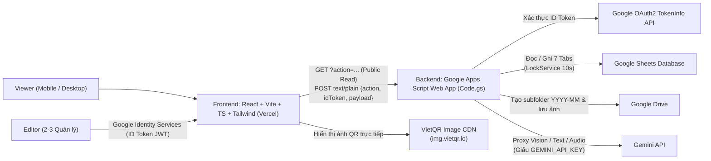

# SPEC.md — Hệ Thống Quản Lý Quỹ Cầu Lông & Chia Tiền Ăn Nhậu

> **Vai trò tài liệu:** Nguồn chân lý duy nhất (Single Source of Truth) cho kiến trúc, phân quyền, nghiệp vụ tính tiền, cơ sở dữ liệu Google Sheets (7 tabs), hợp đồng API (REST over Google Apps Script) và giao diện Mobile-first của dự án.

---

## 1. Tổng quan & Mục tiêu dự án

### 1.1. Bối cảnh & Phạm vi sản phẩm
Dự án xây dựng một Web Application tối ưu cho thiết bị di động (**Mobile-first**) giúp câu lạc bộ cầu lông và hội ăn nhậu sau buổi tập quản lý minh bạch:
- **Quỹ Cầu lông (`BADMINTON`):** Theo dõi đóng quỹ tháng của thành viên chính (`MAIN`), thu phí theo buổi của khách vãng lai (`GUEST`), ghi nhận chi phí sân/cầu/nước và hoàn ứng cho người chi hộ.
- **Chia tiền Ăn nhậu (`DRINKING`):** Chia đều hóa đơn theo số người có mặt (bao gồm cả `MAIN` và `GUEST`), linh hoạt người nhận tiền khi Thủ quỹ vắng mặt.
- **Công nợ & Tối ưu chuyển khoản:** Cộng dồn các khoản chưa trả theo thời gian, chạy thuật toán cấn trừ nợ vòng tròn (**Debt Simplification**), tạo mã **VietQR** tự động điền số tiền và nội dung chuyển khoản.
- **Tích hợp AI (Gemini):** Bóc tách hóa đơn từ ảnh chụp (lưu trữ ảnh trên Google Drive theo tháng `YYYY-MM`) và điểm danh bằng giọng nói tiếng Việt.

### 1.2. Nguyên tắc thiết kế cốt lõi
1. **Viewer Zero-Friction:** Thành viên thường mở link trên điện thoại là xem được ngay toàn bộ báo cáo, sổ quỹ, lịch sử buổi chơi, công nợ cá nhân và quét mã VietQR — **không yêu cầu đăng nhập**.
2. **Google Sheets làm Database minh bạch:** Dễ kiểm tra, đối chiếu thủ công, sao lưu tự nhiên trên Google Drive, không tốn chi phí vận hành server/DB.
3. **GAS làm Backend & Security Proxy:** Toàn bộ logic ghi dữ liệu, xác thực Google ID Token, lưu ảnh Google Drive và gọi Gemini API đều đi qua Google Apps Script (`Code.gs`) để bảo vệ tuyệt đối `GEMINI_API_KEY` và quyền ghi Google Sheet.
4. **Mobile-first UI:** Thao tác một tay, nút bấm lớn, 5 tab điều hướng dưới đáy màn hình, hỗ trợ chụp ảnh trực tiếp từ camera điện thoại và nhập liệu giọng nói song song tick tay.

---

## 2. Kiến trúc hệ thống & Cấu trúc thư mục

### 2.1. Sơ đồ kiến trúc tổng thể



### 2.2. Cấu trúc thư mục dự án

```text
caulong-nhau/
├── SPEC.md                          # Tài liệu đặc tả nguồn chân lý duy nhất
├── frontend/                        # Web App React + Vite + TypeScript + Tailwind (Deploy Vercel)
│   ├── public/                      # Static assets, favicon, manifest
│   └── src/
│       ├── components/              # UI components dùng chung (BottomNav, VietQRModal, VoiceAttend, ...)
│       ├── pages/                   # 5 màn hình chính (Dashboard, Sessions, Debts, FundStats, Manage)
│       ├── services/                # GAS API client, GIS auth helper, image compression
│       ├── types/                   # TypeScript interfaces khớp 100% Schema & API Contract
│       └── utils/                   # Format tiền VND, tính ngày Week/Month/Quarter/Year, VietQR URL builder
└── gas-backend/                     # Google Apps Script REST API (Deploy Web App)
    └── src/                         # Code.gs, Auth.gs, SheetsRepo.gs, DebtEngine.gs, GeminiProxy.gs, DriveService.gs
```

### 2.3. Biến môi trường & Cấu hình

#### Frontend (`/frontend/.env`)
| Biến | Bắt buộc | Mô tả |
| :--- | :--- | :--- |
| `VITE_GAS_API_URL` | Có | URL Web App deployment của Google Apps Script (`https://script.google.com/macros/s/.../exec`) |
| `VITE_GOOGLE_CLIENT_ID` | Có | OAuth 2.0 Client ID (Web Application) dùng cho Google Identity Services |

#### GAS Backend (`PropertiesService.getScriptProperties()`)
| Property Key | Bắt buộc | Mô tả |
| :--- | :--- | :--- |
| `SPREADSHEET_ID` | Có | ID của Google Sheet chứa 7 tabs dữ liệu |
| `DRIVE_ROOT_FOLDER_ID` | Có | ID thư mục gốc trên Google Drive dùng để tự động tạo các subfolder `YYYY-MM` |
| `GEMINI_API_KEY` | Có | API Key của Google Gemini (chỉ lưu ở Script Properties, tuyệt đối không lộ ra Frontend) |
| `GEMINI_MODEL` | Có | Tên model Gemini mặc định (VD: `gemini-2.5-flash`) |
| `GOOGLE_CLIENT_ID` | Có | Trùng với `VITE_GOOGLE_CLIENT_ID`, dùng để xác minh trường `aud` của ID Token |

---

## 3. Phân quyền & Bảo mật (AuthN / AuthZ)

### 3.1. Hai vai trò người dùng
| Vai trò | Điều kiện truy cập | Quyền hạn |
| :--- | :--- | :--- |
| **Viewer** | Không cần đăng nhập | Xem Dashboard tổng quan, danh sách buổi chơi & chi tiết điểm danh/ảnh hóa đơn, bảng công nợ tối ưu & VietQR, sổ quỹ thu/chi, bộ lọc thống kê và bảng vãng lai theo tháng. |
| **Editor** | Đăng nhập Google + email nằm trong tab `Editors` (`is_active = TRUE`) | Toàn bộ quyền Viewer + thấy và sử dụng các chức năng ghi: Tạo/sửa/xóa buổi (`BADMINTON`, `DRINKING`), Chụp ảnh hóa đơn AI, Điểm danh giọng nói AI, Xác nhận đã thanh toán (gạch nợ), Ghi nhận thu/chi quỹ, Quản lý `Members` và `Settings`. |

> **Phân cấp nội bộ trong tab `Editors`:**
> - `EDITOR`: Có toàn bộ quyền thao tác nghiệp vụ (buổi chơi, quỹ, công nợ, thành viên, cài đặt).
> - `ADMIN`: Có toàn bộ quyền của `EDITOR`, cộng thêm quyền thêm/sửa/vô hiệu hóa danh sách trong tab `Editors` (`manageEditors`).

### 3.2. Luồng xác thực Google ID Token trên GAS
1. Ở Frontend, Editor bấm nút **Đăng nhập Google** (Google Identity Services - GIS) để nhận `credential` (Google ID Token dạng JWT).
2. Frontend lưu tạm token trong memory/sessionStorage và gửi kèm `idToken` trong body mọi request `POST` cần quyền ghi (và gọi `verifyEditor` ngay sau khi đăng nhập để kiểm tra quyền và lấy `role`).
3. Trên GAS, hàm `verifyEditorToken(idToken)` thực hiện tuần tự:
   - Gọi `UrlFetchApp.fetch("https://oauth2.googleapis.com/tokeninfo?id_token=" + encodeURIComponent(idToken))`.
   - Kiểm tra HTTP 200 và parse JSON.
   - Xác minh `aud === ScriptProperties.GOOGLE_CLIENT_ID`.
   - Xác minh `email_verified === "true"` hoặc `true`.
   - Xác minh `Number(exp) * 1000 > Date.now()` (token chưa hết hạn).
   - Chuẩn hóa `email = String(payload.email).trim().toLowerCase()`, đối chiếu với tab `Editors`: phải tồn tại dòng có `email` khớp và `is_active === TRUE`.
   - Nếu không hợp lệ: trả về lỗi `UNAUTHORIZED` (token lỗi/hết hạn) hoặc `FORBIDDEN` (email không thuộc danh sách Editors).

### 3.3. Chống xung đột ghi đồng thời (Concurrency Control)
Mọi endpoint `POST` thay đổi dữ liệu Google Sheets **bắt buộc** bọc trong khóa script:
```javascript
const lock = LockService.getScriptLock();
lock.waitLock(10000); // Chờ tối đa 10 giây
try {
  // Thực thi đọc -> kiểm tra -> ghi Sheets
} finally {
  lock.releaseLock();
}
```
Nếu không lấy được lock sau 10 giây, trả về lỗi `CONFLICT_LOCK` để Frontend thông báo người dùng thử lại.

---

## 4. Quy tắc nghiệp vụ chi tiết (Business Logic)

### 4.1. Luồng Cầu lông (`BADMINTON`)

#### A. Thành viên chính (`MAIN`)
- Đóng **quỹ tháng cố định** theo mức trong `Settings.default_monthly_fund` (mặc định `300000` VND, cho phép Editor tùy chỉnh khi nhập thu quỹ).
- Khi đóng quỹ tháng, Editor ghi nhận vào `Fund_Ledger`:
  - `type = INCOME`, `category = MONTHLY_FUND`, `member_id = <member_id>`, `period = "YYYY-MM"`, `is_paid = TRUE`.
- Khi điểm danh buổi cầu lông (`BADMINTON`):
  - Thành viên `MAIN` **không phát sinh tiền theo buổi**: `Attendance.fee_amount = 0`, `Attendance.is_paid = TRUE`.
  - Việc điểm danh phục vụ theo dõi chuyên cần và tính số buổi tham gia.

#### B. Khách vãng lai (`GUEST`)
- Đóng **phí cố định theo buổi**: mặc định lấy từ `Settings.default_guest_fee` (mặc định `50000` VND). Khi tạo/sửa buổi `BADMINTON`, Editor có thể tùy chỉnh `Sessions.guest_fee` riêng cho buổi đó (VD: đánh 3 tiếng thu `70000`).
- Với mỗi `GUEST` có mặt trong buổi `BADMINTON`:
  - `Attendance.fee_amount = session.guest_fee`
  - `Attendance.creditor_id = Settings.treasurer_member_id` (tiền vãng lai thuộc về Quỹ do Thủ quỹ giữ).
  - Nếu vãng lai **đã trả tiền ngay tại sân** (Editor tick "Đã đóng ngay" khi điểm danh):
    - `Attendance.is_paid = TRUE`, `paid_at = now`.
    - Hệ thống **tự động ghi nhận 1 dòng `INCOME` vào `Fund_Ledger`** (`category = GUEST_FEE`, `amount = fee_amount`, `member_id = guest_member_id`, `session_id`, `attendance_id`, `is_paid = TRUE`).
  - Nếu **chưa trả ngay**:
    - `Attendance.is_paid = FALSE`. Khoản này tự động cộng dồn vào công nợ của `GUEST` đối với Thủ quỹ.
    - Sau này khi Editor xác nhận đã thanh toán (qua lệnh chuyển khoản tối ưu hoặc gạch nợ từng khoản), hệ thống cập nhật `Attendance.is_paid = TRUE`, `paid_at`, `settlement_id` và **tự động sinh 1 dòng `INCOME` (`category = GUEST_FEE`) vào `Fund_Ledger`**.
  - **Quy tắc chống ghi trùng (Idempotency):** Trước khi sinh dòng `GUEST_FEE` vào `Fund_Ledger`, GAS kiểm tra xem đã tồn tại dòng có cùng `attendance_id` trong `Fund_Ledger` chưa. Nếu đã có thì không tạo thêm.

#### C. Chi phí sân / cầu / nước (`Fund_Ledger` - `EXPENSE`)
- Khi phát sinh chi phí (`COURT`, `SHUTTLECOCK`, `WATER`, hoặc `OTHER_EXPENSE`), Editor ghi 1 dòng `EXPENSE` vào `Fund_Ledger` và chọn `member_id` là **người đã bỏ tiền ra trả** (mặc định là `Settings.treasurer_member_id`).
- **Trường hợp 1 (`member_id === Settings.treasurer_member_id`):** Thủ quỹ chi trực tiếp từ quỹ -> `is_paid = TRUE`, `paid_at = date`. Số dư quỹ giảm tương ứng `amount`.
- **Trường hợp 2 (`member_id !== Settings.treasurer_member_id`):** Thành viên khác ứng tiền hộ quỹ -> `is_paid = FALSE`, `paid_at = null`.
  - Số dư sổ quỹ (`Fund_Ledger`) vẫn tính đây là khoản chi của CLB (giảm quỹ).
  - Đồng thời, trên đồ thị công nợ, khoản này tạo ra **công nợ Quỹ (đại diện bởi `treasurer_member_id`) phải hoàn lại `amount` cho `member_id`**.
  - Khi Thủ quỹ hoàn tiền (hoặc khoản này được cấn trừ qua Debt Simplification), `Fund_Ledger.is_paid` chuyển thành `TRUE`, ghi `paid_at` và `settlement_id`.

---

### 4.2. Luồng Ăn nhậu (`DRINKING`)
- Tổng tiền hóa đơn `Sessions.total_amount` (nhập tay hoặc bóc từ AI Receipt) được **chia đều cho tất cả người có mặt** (`attendee_count`, bao gồm cả `MAIN` và `GUEST`).
- **Công thức làm tròn:** Sử dụng `unit = Number(Settings.rounding_unit || 1000)`:
  $$\text{per\_person\_amount} = \text{Math.round}\left(\frac{\text{total\_amount}}{\text{attendee\_count} \times \text{unit}}\right) \times \text{unit}$$
- **Người nhận tiền (`Sessions.payer_id`):**
  - Mặc định là `Settings.treasurer_member_id`.
  - Nếu buổi nhậu đó Thủ quỹ không tham gia hoặc có thành viên khác thanh toán hóa đơn trước, Editor chọn thành viên đó làm `payer_id` của buổi.
- **Sinh bản ghi `Attendance`:**
  - Nếu `member_id === session.payer_id` (chính người ứng tiền): `fee_amount = per_person_amount`, `creditor_id = session.payer_id`, **`is_paid = TRUE`**, `paid_at = session.date` (tự cấn trừ phần của mình).
  - Với mọi thành viên có mặt khác (`member_id !== session.payer_id`): `fee_amount = per_person_amount`, `creditor_id = session.payer_id`, **`is_paid = FALSE`**.

---

### 4.3. Công nợ, Thuật toán Debt Simplification & Đối soát (Reconciliation)

#### A. Hợp nhất tài khoản Quỹ & Thủ quỹ
Để tránh tình trạng một người vừa phải chuyển khoản cho "Quỹ" vừa phải chuyển khoản cho "Thủ quỹ" (hoặc Thủ quỹ nợ quỹ), hệ thống quy ước:
- **Thủ quỹ (`Settings.treasurer_member_id`) là đại diện pháp nhân thu/chi công nợ của Quỹ trên đồ thị thanh toán.**
- Nhờ đó, nếu A nợ tiền vãng lai Quỹ `50.000đ` và Thủ quỹ đang nợ A `200.000đ` tiền ứng mua ống cầu, thuật toán sẽ tự động cấn trừ thành **Thủ quỹ chỉ cần chuyển cho A `150.000đ`**.

#### B. Tính số dư ròng (`netBalance`) của từng thành viên
Khởi tạo `netBalance[m] = 0` cho mọi thành viên (`netBalance > 0` là **đang được nhận tiền / chủ nợ**, `netBalance < 0` là **đang phải trả tiền / con nợ**). Cộng dồn từ 3 nguồn dữ liệu:

1. **Từ `Attendance` (các khoản `is_paid = FALSE` và `fee_amount > 0`):**
   - `netBalance[row.member_id] -= row.fee_amount`
   - `netBalance[row.creditor_id] += row.fee_amount`
2. **Từ `Fund_Ledger` (các khoản hoàn ứng: `type = EXPENSE` và `is_paid = FALSE` và `member_id !== treasurer_member_id`):**
   - `netBalance[treasurer_member_id] -= row.amount`
   - `netBalance[row.member_id] += row.amount`
3. **Từ `Settlements` (các giao dịch đã xác nhận chuyển tiền nhưng chưa tất toán hết nhóm liên thông: `is_reconciled = FALSE`):**
   - `netBalance[row.from_member_id] += row.amount`
   - `netBalance[row.to_member_id] -= row.amount`

> **Lưu ý:** Luôn giữ bất biến $\sum_{m} \text{netBalance}[m] = 0$. Mọi tính toán đều thực hiện bằng số nguyên VND.

#### C. Thuật toán Greedy Debt Simplification
Mục tiêu: Giảm số lần chuyển khoản xuống tối thiểu (tự động triệt tiêu nợ vòng tròn `A -> B -> C` thành `A -> C` hoặc `A -> B` và `B -> C` gộp thành một lệnh).

Các bước thực hiện:
1. Lọc danh sách `debtors` gồm các thành viên có `netBalance < 0` (lưu `{ memberId, amount: -netBalance }`), sắp xếp giảm dần theo `amount`.
2. Lọc danh sách `creditors` gồm các thành viên có `netBalance > 0` (lưu `{ memberId, amount: netBalance }`), sắp xếp giảm dần theo `amount`.
3. Dùng hai con trỏ `i = 0` (debtors) và `j = 0` (creditors):
   - Khi `i < debtors.length` và `j < creditors.length`:
     - `transferAmount = Math.min(debtors[i].amount, creditors[j].amount)`
     - Nếu `transferAmount > 0`: đẩy `{ fromMemberId: debtors[i].memberId, toMemberId: creditors[j].memberId, amount: transferAmount }` vào danh sách `simplifiedTransfers`.
     - Trừ `transferAmount` khỏi `debtors[i].amount` và `creditors[j].amount`.
     - Nếu `debtors[i].amount === 0` thì `i++`; nếu `creditors[j].amount === 0` thì `j++`.
4. Trả về `simplifiedTransfers` kèm thông tin ngân hàng của `toMemberId` và URL VietQR tương ứng.

#### D. Quy tắc đối soát khi Editor bấm "Xác nhận đã thanh toán" (`confirmSettlement`)
Hỗ trợ 2 chế độ xác nhận để phù hợp cả chuyển khoản cấn trừ lẫn trả tiền mặt từng buổi:

- **Chế độ 1: `mode = "SIMPLIFIED_TRANSFER"` (Xác nhận theo lệnh chuyển khoản tối ưu)**
  1. Ghi 1 bản ghi vào `Settlements` (`from_member_id`, `to_member_id`, `amount`, `settled_at`, `method`, `is_reconciled = FALSE`, `confirmed_by`).
  2. **Tự động ghi nhận quỹ cho phần vãng lai của người chuyển:**
     - Quét các dòng `Attendance` của `from_member_id` thỏa: `session_type === "BADMINTON"`, `member_type_snapshot === "GUEST"`, `is_paid === FALSE`, sắp xếp tăng dần theo `session_date` (FIFO).
     - Khi `from_member_id` đã chuyển một khoản `amount` (và tổng nợ ròng của `from_member_id` giảm đi), phân bổ FIFO từ `amount` vào các dòng `Attendance` vãng lai chưa trả (chỉ đánh dấu `is_paid = TRUE` cho các dòng có `fee_amount <= remainingBudget` — hoặc nếu trả hết `netBalance` của `from_member_id` về `0` thì toàn bộ các dòng `Attendance` mà `from_member_id` là con nợ đều được đánh dấu `is_paid = TRUE`, `paid_at = now`, `settlement_id`).
     - Với mỗi dòng `Attendance` (`BADMINTON` + `GUEST`) vừa chuyển sang `is_paid = TRUE`: tự động tạo 1 dòng `INCOME` (`category = GUEST_FEE`) trong `Fund_Ledger` (kiểm tra idempotency theo `attendance_id`).
  3. **Kiểm tra tất toán (Reconciliation):**
     - Tính lại `netBalance` sau khi ghi nhận `Settlement`.
     - Nếu `netBalance[from_member_id] === 0` và `netBalance[to_member_id] === 0` (hoặc toàn bộ thành viên trong thành phần liên thông của giao dịch đều có `netBalance === 0`):
       - Đánh dấu tất cả `Attendance` (`is_paid = FALSE`) và `Fund_Ledger` (`EXPENSE`, `is_paid = FALSE`) thuộc nhóm đã về `0` thành `is_paid = TRUE`, `paid_at = now`, `settlement_id`.
       - Đánh dấu các `Settlements` (`is_reconciled = FALSE`) thuộc nhóm đó thành `is_reconciled = TRUE`.
     - Nếu trong chuỗi cấn trừ còn người thứ 3 chưa chuyển xong (VD: `A -> C` đã xong nhưng `B -> C` chưa xong nên `netBalance[C] > 0`), các dòng `Attendance`/`Fund_Ledger` chưa tất toán hết sẽ chờ đến khi toàn bộ chuỗi liên quan hoàn tất, trong khi `netBalance` và `simplifiedTransfers` luôn hiển thị chính xác phần còn lại theo thời gian thực nhờ nguồn (3) từ `Settlements (is_reconciled = FALSE)`.

- **Chế độ 2: `mode = "ITEMS"` (Gạch nợ đích danh từng khoản `attendanceIds` / `ledgerIds`)**
  1. Dùng khi thành viên/vãng lai trả tiền mặt trực tiếp cho đúng buổi đó (VD: trả riêng `50.000đ` tiền sân hôm thứ 4 mà không gộp với tiền nhậu).
  2. Tính tổng tiền các item được chọn, ghi 1 dòng vào `Settlements` (`is_reconciled = TRUE`, `source_attendance_ids`, `source_ledger_ids`).
  3. Đánh dấu trực tiếp các `Attendance` / `Fund_Ledger` trong danh sách là `is_paid = TRUE`, `paid_at = now`, `settlement_id`.
  4. Nếu có item thuộc `BADMINTON` `GUEST`, tự động tạo dòng `INCOME` (`GUEST_FEE`) trong `Fund_Ledger`.

---

### 4.4. Tích hợp VietQR
- Sử dụng API tạo ảnh VietQR công khai theo chuẩn:
  ```text
  https://img.vietqr.io/image/{bank_bin}-{account_no}-{template}.png?amount={amount}&addInfo={encoded_content}&accountName={encoded_name}
  ```
- Trong đó:
  - `bank_bin`: Mã BIN ngân hàng (VD: `970436` - Vietcombank, `970415` - VietinBank, `970422` - MB Bank, `970407` - Techcombank) lấy từ `Members.bank_bin` của người nhận (`toMemberId`).
  - `template`: Đọc từ `Settings.vietqr_template` (mặc định `compact2` — hiển thị QR, số tiền, nội dung, tên tài khoản).
  - `addInfo`: Chuẩn hóa không dấu, tối đa 50 ký tự theo format `{prefix} {ten_nguoi_chuyen} tra {ten_nguoi_nhan}` (VD: `CLN Tuan tra Hung`), trong đó `prefix` lấy từ `Settings.transfer_prefix` (mặc định `CLN`).
- Nếu người nhận (`toMemberId`) chưa cấu hình `bank_bin` hoặc `account_no` trong `Members`, UI hiển thị cảnh báo nhắc Editor cập nhật thông tin ngân hàng cho thành viên đó và vẫn cho phép xác nhận thanh toán tiền mặt.

---

## 5. Tính năng AI thông minh (Gemini Proxy qua GAS)

Toàn bộ lệnh gọi Gemini API chạy ở phía GAS (`GeminiProxy.gs`) thông qua `UrlFetchApp.fetch("https://generativelanguage.googleapis.com/v1beta/models/" + model + ":generateContent?key=" + apiKey, ...)` để **giấu hoàn toàn `GEMINI_API_KEY`**.

### 5.1. Chụp / Tải ảnh hóa đơn (`parseReceipt`)
1. **Phía Frontend:**
   - Cho phép Editor chụp ảnh từ camera (`<input type="file" accept="image/*" capture="environment">`) hoặc chọn ảnh từ thư viện.
   - Nén ảnh trên trình duyệt (Canvas resize cạnh dài tối đa `1280px`, định dạng `image/jpeg`, chất lượng `0.8`) để đảm bảo payload gửi GAS nhỏ gọn (< 500KB) và phản hồi nhanh.
2. **Phía GAS:**
   - Tự động tìm trong `DRIVE_ROOT_FOLDER_ID` thư mục con có tên đúng định dạng `YYYY-MM` (theo ngày của buổi hoặc tháng hiện tại). Nếu chưa có thì tự động tạo mới.
   - Lưu file ảnh vào subfolder `YYYY-MM` với tên `receipt_{YYYYMMDD}_{HHmmss}.jpg`.
   - Thiết lập quyền chia sẻ `DriveApp.Access.ANYONE_WITH_LINK`, `DriveApp.Permission.VIEW` để Viewer có thể xem ảnh hóa đơn minh bạch ngay trên Web App.
   - Gửi ảnh base64 sang Gemini Vision API (`responseMimeType: "application/json"`) yêu cầu bóc tách:
     - `totalAmount` (số nguyên VND, loại bỏ dấu chấm/phẩy; nếu hóa đơn có thuế/phí phục vụ/giảm giá thì lấy **tổng thanh toán cuối cùng**).
     - `itemsSummary` (chuỗi tóm tắt ngắn gọn tiếng Việt các món chính, VD: `"Lẩu gà (2), Bia Tiger (12), Khăn lạnh (8)"`).
     - `items` (mảng chi tiết `{ name, qty, price }`).
     - `merchantName` (tên quán/sân nếu đọc được).
     - `confidence` (`"HIGH" | "MEDIUM" | "LOW"`).
3. **Trên UI:**
   - Tự động điền `total_amount`, `receipt_summary`, `receipt_drive_id`, `receipt_url` vào form tạo buổi.
   - Editor luôn có quyền kiểm tra và chỉnh sửa lại số tiền hoặc ghi chú trước khi bấm **Lưu buổi**.

### 5.2. Điểm danh bằng giọng nói (`parseVoiceAttendance`)
1. **Hai chế độ thu thập đầu vào trên Frontend:**
   - **Chế độ ưu tiên (Text Transcript):** Nếu trình duyệt hỗ trợ Web Speech API (`SpeechRecognition` / `webkitSpeechRecognition`, `lang = "vi-VN"`), thu âm trực tiếp thành văn bản tiếng Việt và cho Editor nhìn thấy chữ chạy theo thời gian thực, rồi gửi `transcript` lên GAS.
   - **Chế độ Fallback (Audio Upload):** Trên các trình duyệt không hỗ trợ Web Speech API (như iOS Safari / một số WebView), dùng `MediaRecorder` thu đoạn âm thanh ngắn (`.webm` / `.mp4`) chuyển sang `audioBase64` + `mimeType` gửi lên GAS để Gemini nghe trực tiếp.
2. **Xử lý phía GAS:**
   - Đọc danh sách thành viên đang hoạt động (`is_active = TRUE`) từ tab `Members`: `{ member_id, name, aliases, type }`.
   - Gửi `transcript` (hoặc `audioBase64`) kèm danh sách thành viên vào Gemini API với prompt đối chiếu thông minh:
     - Khớp theo tên đầy đủ, tên gọi tắt, biệt danh trong `aliases`, xử lý lỗi phát âm/nhận dạng tiếng Việt (VD: "Tuấn mập", "anh Hùng", "Bé Na").
     - Phân biệt ngữ cảnh vãng lai mới (VD: *"thêm vãng lai Minh, Khoa"*, *"có bạn của Hùng tên Nam mới đi lần đầu"*).
     - Yêu cầu trả về JSON chuẩn:
       ```json
       {
         "rawTranscript": "Hôm nay có Tuấn, Hùng, thêm vãng lai Minh, Khoa",
         "matchedMemberIds": ["MEM_001", "MEM_002"],
         "uncertainMatches": [
           { "spokenName": "Huy", "candidates": ["MEM_005", "MEM_009"] }
         ],
         "newGuests": [
           { "name": "Minh", "spokenText": "vãng lai Minh" },
           { "name": "Khoa", "spokenText": "Khoa" }
         ]
       }
       ```
3. **Trải nghiệm trên UI (Song song AI + Tick tay):**
   - Các thành viên trong `matchedMemberIds` được **tự động tick chọn** trong danh sách điểm danh.
   - Nếu có `uncertainMatches` (trùng tên, VD có 2 người tên Huy), UI làm nổi bật các ứng viên để Editor chạm chọn đúng người.
   - Danh sách `newGuests` hiển thị ở khu vực riêng **"Vãng lai mới phát hiện"** kèm nút bấm **1 chạm ("+ Thêm & Điểm danh")**: khi bấm, hệ thống cho phép tạo nhanh thành viên `type = GUEST` (hoặc gửi kèm trong `createSession` dưới dạng `quickNewGuests` để tạo member mới và điểm danh trong 1 lần gọi API duy nhất).
   - Editor vẫn luôn tick/bỏ tick thủ công hoặc gõ ô tìm kiếm để thêm/bớt người song song bất cứ lúc nào.

---

## 6. Database Schema (Google Sheets — 7 Tabs)

Quy ước chung cho toàn bộ Google Sheet:
- Dòng 1 (`Row 1`) của mỗi tab là **Header chính xác** (phân biệt chữ hoa/thường theo đúng tên cột dưới đây).
- Thời gian lưu chuẩn **ISO 8601 UTC hoặc `+07:00`** (VD: `2026-11-25T19:30:00+07:00`), riêng cột ngày lưu định dạng `YYYY-MM-DD` (lưu kiểu Plain Text trên Sheet để tránh Google Sheets tự convert sai locale).
- Tiền tệ lưu số nguyên VND (`INTEGER`, không dấu phẩy, không chữ `đ`).
- Cột boolean dùng `TRUE` / `FALSE` chuẩn Google Sheets.

### 6.1. Tab `Members` — Danh sách thành viên & Vãng lai
| STT | Tên cột | Kiểu dữ liệu | Ràng buộc / Key | Mô tả & Ví dụ |
| :--- | :--- | :--- | :--- | :--- |
| 1 | `member_id` | String | **PK**, Not Null | Mã định danh duy nhất (VD: `MEM_001`) |
| 2 | `name` | String | Not Null | Tên hiển thị chính thức (VD: `Nguyễn Anh Tuấn`) |
| 3 | `aliases` | String | Optional | Các tên gọi/biệt danh phân cách bởi dấu phẩy cho AI đối chiếu (VD: `Tuấn, Tuấn mập, Tũn`) |
| 4 | `type` | Enum | Not Null | `MAIN` (Thành viên chính) \| `GUEST` (Khách vãng lai) |
| 5 | `phone` | String | Optional | Số điện thoại liên hệ (Plain Text, VD: `'0901234567`) |
| 6 | `bank_bin` | String | Optional | Mã BIN VietQR ngân hàng (VD: `970436`) |
| 7 | `bank_name` | String | Optional | Tên viết tắt ngân hàng (VD: `Vietcombank`, `MB`) |
| 8 | `account_no` | String | Optional | Số tài khoản ngân hàng (Plain Text để giữ số `0` đầu) |
| 9 | `account_name` | String | Optional | Tên chủ tài khoản không dấu viết hoa (VD: `NGUYEN ANH TUAN`) |
| 10 | `is_active` | Boolean | Not Null | `TRUE` (đang sinh hoạt) \| `FALSE` (đã nghỉ/ẩn) |
| 11 | `created_at` | DateTime | Not Null | Thời điểm tạo ISO 8601 |
| 12 | `updated_at` | DateTime | Not Null | Thời điểm cập nhật gần nhất ISO 8601 |

### 6.2. Tab `Sessions` — Lịch sử các buổi Cầu lông & Ăn nhậu
| STT | Tên cột | Kiểu dữ liệu | Ràng buộc / Key | Mô tả & Ví dụ |
| :--- | :--- | :--- | :--- | :--- |
| 1 | `session_id` | String | **PK**, Not Null | Mã buổi duy nhất (VD: `SES_20261125_001`) |
| 2 | `date` | Date (`YYYY-MM-DD`) | Not Null | Ngày diễn ra buổi (Plain Text, VD: `2026-11-25`) |
| 3 | `type` | Enum | Not Null | `BADMINTON` (Cầu lông) \| `DRINKING` (Ăn nhậu) |
| 4 | `title` | String | Not Null | Tiêu đề ngắn (VD: `Cầu lông tối T4`, `Nhậu Lẩu Dê`) |
| 5 | `total_amount` | Integer | Not Null | `BADMINTON`: `0` (chi phí sân/cầu ghi vào `Fund_Ledger`); `DRINKING`: tổng hóa đơn bàn nhậu (VND) |
| 6 | `guest_fee` | Integer | Not Null | `BADMINTON`: phí vãng lai áp dụng cho buổi này (mặc định `50000`); `DRINKING`: `0` |
| 7 | `payer_id` | String | **FK -> Members.member_id** | Người nhận tiền của buổi (mặc định `treasurer_member_id`; với `DRINKING` có thể là người ứng bill) |
| 8 | `per_person_amount` | Integer | Not Null | `DRINKING`: tiền chia mỗi người (đã làm tròn); `BADMINTON`: `0` |
| 9 | `attendee_count` | Integer | Not Null | Tổng số người có mặt trong buổi |
| 10 | `receipt_drive_id` | String | Optional | Google Drive File ID của ảnh hóa đơn (nếu có) |
| 11 | `receipt_url` | String | Optional | Link xem ảnh hóa đơn trên Google Drive |
| 12 | `receipt_summary` | String | Optional | Tóm tắt các món từ hóa đơn (do AI bóc hoặc Editor nhập) |
| 13 | `note` | String | Optional | Ghi chú thêm của buổi |
| 14 | `created_by` | String | Not Null | Email của Editor tạo buổi |
| 15 | `created_at` | DateTime | Not Null | Thời điểm tạo ISO 8601 |
| 16 | `updated_at` | DateTime | Not Null | Thời điểm cập nhật gần nhất ISO 8601 |

### 6.3. Tab `Attendance` — Chi tiết điểm danh & Công nợ theo buổi
| STT | Tên cột | Kiểu dữ liệu | Ràng buộc / Key | Mô tả & Ví dụ |
| :--- | :--- | :--- | :--- | :--- |
| 1 | `attendance_id` | String | **PK**, Not Null | Mã điểm danh (VD: `ATT_20261125_001`) |
| 2 | `session_id` | String | **FK -> Sessions.session_id** | Mã buổi tương ứng |
| 3 | `session_date` | Date (`YYYY-MM-DD`) | Not Null | Ngày của buổi (denormalize để lọc nhanh báo cáo/thống kê) |
| 4 | `session_type` | Enum | Not Null | `BADMINTON` \| `DRINKING` |
| 5 | `member_id` | String | **FK -> Members.member_id** | Người tham gia |
| 6 | `member_type_snapshot` | Enum | Not Null | `MAIN` \| `GUEST` tại thời điểm điểm danh (tránh sai lệch lịch sử nếu sau này `GUEST` lên `MAIN`) |
| 7 | `fee_amount` | Integer | Not Null | Số tiền phải đóng cho buổi này (`0` nếu `MAIN` đi `BADMINTON`; `guest_fee` nếu `GUEST` đi `BADMINTON`; `per_person_amount` nếu `DRINKING`) |
| 8 | `creditor_id` | String | **FK -> Members.member_id** | Người cần trả tiền cho khoản này (Thủ quỹ hoặc `Sessions.payer_id`) |
| 9 | `is_paid` | Boolean | Not Null | `TRUE` (đã trả/không phát sinh nợ) \| `FALSE` (đang nợ) |
| 10 | `paid_at` | DateTime | Optional | Thời điểm gạch nợ |
| 11 | `settlement_id` | String | **FK -> Settlements.settlement_id** | Mã giao dịch tất toán đã gạch nợ khoản này |
| 12 | `note` | String | Optional | Ghi chú (VD: `Đóng tiền mặt tại sân`) |

### 6.4. Tab `Fund_Ledger` — Sổ quỹ Cầu lông (Thu / Chi / Hoàn ứng)
| STT | Tên cột | Kiểu dữ liệu | Ràng buộc / Key | Mô tả & Ví dụ |
| :--- | :--- | :--- | :--- | :--- |
| 1 | `ledger_id` | String | **PK**, Not Null | Mã bút toán quỹ (VD: `LED_20261125_001`) |
| 2 | `date` | Date (`YYYY-MM-DD`) | Not Null | Ngày phát sinh giao dịch |
| 3 | `type` | Enum | Not Null | `INCOME` (Thu vào quỹ) \| `EXPENSE` (Chi từ quỹ) |
| 4 | `category` | Enum | Not Null | `MONTHLY_FUND` \| `GUEST_FEE` \| `OTHER_INCOME` \| `COURT` \| `SHUTTLECOCK` \| `WATER` \| `OTHER_EXPENSE` |
| 5 | `amount` | Integer | Not Null | Số tiền giao dịch (VND, luôn dương `> 0`) |
| 6 | `member_id` | String | **FK -> Members.member_id** | `INCOME`: người đóng tiền; `EXPENSE`: người bỏ tiền ra chi hộ/trả tiền |
| 7 | `session_id` | String | Optional, **FK -> Sessions** | Gắn với buổi cầu lông cụ thể (nếu có) |
| 8 | `attendance_id` | String | Optional, **FK -> Attendance** | Gắn với dòng điểm danh `GUEST_FEE` (dùng chống trùng lặp khi ghi quỹ) |
| 9 | `period` | String (`YYYY-MM`) | Optional | Kỳ đóng quỹ tháng (bắt buộc khi `category = MONTHLY_FUND`, VD: `2026-11`) |
| 10 | `is_paid` | Boolean | Not Null | Với `INCOME`: luôn `TRUE`. Với `EXPENSE`: `TRUE` nếu Thủ quỹ chi trực tiếp hoặc đã hoàn ứng; `FALSE` nếu thành viên khác ứng hộ chưa được hoàn |
| 11 | `paid_at` | DateTime | Optional | Thời điểm đã hoàn ứng xong |
| 12 | `settlement_id` | String | Optional, **FK -> Settlements** | Mã giao dịch đã hoàn ứng khoản chi hộ này |
| 13 | `receipt_drive_id` | String | Optional | Drive File ID ảnh hóa đơn tiền sân/cầu/nước (nếu có) |
| 14 | `receipt_url` | String | Optional | Link ảnh hóa đơn |
| 15 | `description` | String | Not Null | Diễn giải (VD: `Tiền sân tháng 11`, `2 ống cầu Hải Yến`) |
| 16 | `created_by` | String | Not Null | Email Editor tạo dòng sổ quỹ |
| 17 | `created_at` | DateTime | Not Null | Thời điểm tạo ISO 8601 |

### 6.5. Tab `Settlements` — Lịch sử xác nhận thanh toán & Gạch nợ
| STT | Tên cột | Kiểu dữ liệu | Ràng buộc / Key | Mô tả & Ví dụ |
| :--- | :--- | :--- | :--- | :--- |
| 1 | `settlement_id` | String | **PK**, Not Null | Mã thanh toán (VD: `SET_20261125_001`) |
| 2 | `from_member_id` | String | **FK -> Members.member_id** | Người chuyển tiền / người trả |
| 3 | `to_member_id` | String | **FK -> Members.member_id** | Người nhận tiền |
| 4 | `amount` | Integer | Not Null | Số tiền đã xác nhận thanh toán (VND) |
| 5 | `settled_at` | DateTime | Not Null | Thời điểm xác nhận thanh toán |
| 6 | `method` | Enum | Not Null | `VIETQR` \| `CASH` \| `BANK_TRANSFER` |
| 7 | `source_attendance_ids` | String | Optional | Danh sách `attendance_id` được gạch trực tiếp (phân cách bởi dấu phẩy) |
| 8 | `source_ledger_ids` | String | Optional | Danh sách `ledger_id` hoàn ứng được gạch trực tiếp (phân cách bởi dấu phẩy) |
| 9 | `is_reconciled` | Boolean | Not Null | `TRUE` nếu đã tất toán xong vào `Attendance`/`Fund_Ledger`; `FALSE` nếu đang nằm trong chuỗi cấn trừ chưa đóng hết |
| 10 | `transfer_content` | String | Optional | Nội dung chuyển khoản VietQR (VD: `CLN Tuan tra Hung`) |
| 11 | `note` | String | Optional | Ghi chú thêm |
| 12 | `confirmed_by` | String | Not Null | Email Editor bấm "Xác nhận đã thanh toán" |

### 6.6. Tab `Settings` — Cấu hình hệ thống
| STT | Tên cột | Kiểu dữ liệu | Ràng buộc / Key | Mô tả & Ví dụ |
| :--- | :--- | :--- | :--- | :--- |
| 1 | `key` | String | **PK**, Not Null | Khóa cấu hình |
| 2 | `value` | String | Not Null | Giá trị cấu hình (lưu dạng String, backend/frontend parse theo key) |
| 3 | `description` | String | Not Null | Mô tả ý nghĩa |
| 4 | `updated_at` | DateTime | Not Null | Thời điểm cập nhật gần nhất |
| 5 | `updated_by` | String | Not Null | Email Editor cập nhật |

**Các khóa mặc định cần khởi tạo trong `Settings`:**
| `key` | Giá trị mặc định | Mô tả |
| :--- | :--- | :--- |
| `club_name` | `CLB Cầu Lông & Nhậu` | Tên hiển thị trên tiêu đề Web App |
| `treasurer_member_id` | `MEM_001` | `member_id` của Thủ quỹ (người giữ quỹ chung và nhận tiền mặc định) |
| `default_monthly_fund` | `300000` | Mức đóng quỹ tháng mặc định cho thành viên `MAIN` (VND) |
| `default_guest_fee` | `50000` | Phí vãng lai mặc định mỗi buổi cầu lông (VND) |
| `rounding_unit` | `1000` | Bội số làm tròn khi chia tiền ăn nhậu (VND) |
| `vietqr_template` | `compact2` | Template ảnh VietQR (`compact`, `compact2`, `qr_only`, `print`) |
| `transfer_prefix` | `CLN` | Tiền tố nội dung chuyển khoản VietQR |

### 6.7. Tab `Editors` — Danh sách quản lý được phép chỉnh sửa
| STT | Tên cột | Kiểu dữ liệu | Ràng buộc / Key | Mô tả & Ví dụ |
| :--- | :--- | :--- | :--- | :--- |
| 1 | `email` | String | **PK**, Not Null | Email Google viết thường toàn bộ (VD: `tuan.ha@gmail.com`) |
| 2 | `name` | String | Not Null | Tên người quản lý |
| 3 | `role` | Enum | Not Null | `ADMIN` (quản trị cao nhất, sửa được tab `Editors`) \| `EDITOR` (quản lý nghiệp vụ) |
| 4 | `is_active` | Boolean | Not Null | `TRUE` (có hiệu lực) \| `FALSE` (bị thu hồi quyền) |
| 5 | `added_at` | DateTime | Not Null | Thời điểm cấp quyền ISO 8601 |

---

## 7. API Contract (Frontend <-> Google Apps Script)

### 7.1. Quy ước giao thức & CORS trên GAS
Google Apps Script Web App (`doGet` / `doPost`) chuyển hướng `302` và **không hỗ trợ HTTP `OPTIONS` preflight cho custom headers hoặc `application/json`**. Do đó quy ước bắt buộc:
1. **Read (Public):** Dùng HTTP `GET` với query params:
   `GET {VITE_GAS_API_URL}?action=<actionName>&param1=...`
2. **Write / Auth / AI:** Dùng HTTP `POST` với **`Content-Type: text/plain;charset=utf-8`** (Simple Request để trình duyệt bỏ qua preflight `OPTIONS`). Body là chuỗi JSON:
   ```json
   {
     "action": "createSession",
     "idToken": "<GOOGLE_ID_TOKEN_JWT>",
     "payload": { ... }
   }
   ```
3. **Standard Response Envelope:** Mọi API đều trả về HTTP 200 kèm JSON theo cấu trúc:
   ```json
   {
     "ok": true,
     "data": { ... },
     "meta": {
       "timestamp": "2026-11-25T14:40:00+07:00"
     },
     "error": null
   }
   ```
   Khi có lỗi:
   ```json
   {
     "ok": false,
     "data": null,
     "meta": {
       "timestamp": "2026-11-25T14:40:00+07:00"
     },
     "error": {
       "code": "UNAUTHORIZED",
       "message": "Token hết hạn hoặc không hợp lệ."
     }
   }
   ```

**Bảng Error Codes chuẩn:**
| Code | Ý nghĩa |
| :--- | :--- |
| `BAD_REQUEST` | Thiếu tham số hoặc dữ liệu đầu vào sai định dạng |
| `UNAUTHORIZED` | Thiếu `idToken`, token giả mạo hoặc đã hết hạn |
| `FORBIDDEN` | Email hợp lệ nhưng không có trong tab `Editors` (`is_active = TRUE`), hoặc không đủ quyền `ADMIN` |
| `NOT_FOUND` | Không tìm thấy `session_id`, `member_id`, `ledger_id`... |
| `CONFLICT_LOCK` | Server đang bận ghi dữ liệu đồng thời (quá thời gian `waitLock`) |
| `GEMINI_ERROR` | Lỗi kết nối Gemini API hoặc kết quả trả về không parse được JSON |
| `DRIVE_ERROR` | Lỗi truy cập/tạo thư mục hoặc lưu file trên Google Drive |
| `INTERNAL_ERROR` | Lỗi hệ thống không xác định |

---

### 7.2. Public Read APIs (`GET`)

#### 1) `GET ?action=bootstrap`
- **Mục đích:** Tải dữ liệu nền một lần khi mở app (Settings công khai, danh sách Members, thông tin Thủ quỹ).
- **Response `data`:**
  ```json
  {
    "settings": {
      "club_name": "CLB Cầu Lông & Nhậu",
      "treasurer_member_id": "MEM_001",
      "default_monthly_fund": 300000,
      "default_guest_fee": 50000,
      "rounding_unit": 1000,
      "vietqr_template": "compact2",
      "transfer_prefix": "CLN"
    },
    "members": [
      {
        "member_id": "MEM_001",
        "name": "Nguyễn Anh Tuấn",
        "aliases": "Tuấn, Tuấn mập",
        "type": "MAIN",
        "phone": "0901234567",
        "bank_bin": "970436",
        "bank_name": "Vietcombank",
        "account_no": "0123456789",
        "account_name": "NGUYEN ANH TUAN",
        "is_active": true
      }
    ]
  }
  ```

#### 2) `GET ?action=getDashboard&periodType=MONTH&refDate=2026-11-25`
- **Query Params:** `periodType` (`WEEK` | `MONTH` | `QUARTER` | `YEAR`), `refDate` (`YYYY-MM-DD`, mặc định hôm nay).
- **Response `data`:**
  ```json
  {
    "period": { "type": "MONTH", "startDate": "2026-11-01", "endDate": "2026-11-30", "label": "Tháng 11/2026" },
    "fund": {
      "currentBalance": 2450000,
      "periodIncome": 3600000,
      "periodExpense": 2150000,
      "pendingReimbursement": 350000
    },
    "debtsSummary": {
      "totalOutstanding": 850000,
      "pendingTransferCount": 4
    },
    "recentSessions": [ ... ],
    "monthlyFundStatus": [
      { "member_id": "MEM_001", "name": "Nguyễn Anh Tuấn", "paidAmount": 300000, "isPaid": true }
    ]
  }
  ```

#### 3) `GET ?action=getSessions&type=ALL&startDate=2026-11-01&endDate=2026-11-30`
- **Query Params:** `type` (`ALL` | `BADMINTON` | `DRINKING`), `startDate`, `endDate` (tùy chọn).
- **Response `data`:** `{ "sessions": [ ... ] }` (danh sách buổi sắp xếp mới nhất lên đầu).

#### 4) `GET ?action=getSessionDetail&sessionId=SES_20261125_001`
- **Query Params:** `sessionId` (bắt buộc).
- **Response `data`:**
  ```json
  {
    "session": { ... },
    "attendances": [
      {
        "attendance_id": "ATT_001",
        "member_id": "MEM_004",
        "member_name": "Minh",
        "member_type_snapshot": "GUEST",
        "fee_amount": 50000,
        "creditor_id": "MEM_001",
        "is_paid": false,
        "paid_at": null
      }
    ],
    "linkedExpenses": [ ... ]
  }
  ```

#### 5) `GET ?action=getDebts`
- **Mục đích:** Lấy kết quả Debt Simplification, danh sách nợ chi tiết từng khoản và lịch sử thanh toán gần đây.
- **Response `data`:**
  ```json
  {
    "treasurerMemberId": "MEM_001",
    "netBalances": [
      { "memberId": "MEM_004", "name": "Minh", "balance": -150000 },
      { "memberId": "MEM_001", "name": "Tuấn (Thủ quỹ)", "balance": 150000 }
    ],
    "simplifiedTransfers": [
      {
        "fromMemberId": "MEM_004",
        "fromName": "Minh",
        "toMemberId": "MEM_001",
        "toName": "Nguyễn Anh Tuấn",
        "amount": 150000,
        "transferContent": "CLN Minh tra Tuan",
        "toBank": {
          "bankBin": "970436",
          "bankName": "Vietcombank",
          "accountNo": "0123456789",
          "accountName": "NGUYEN ANH TUAN"
        },
        "vietQrUrl": "https://img.vietqr.io/image/970436-0123456789-compact2.png?amount=150000&addInfo=CLN%20Minh%20tra%20Tuan&accountName=NGUYEN%20ANH%20TUAN"
      }
    ],
    "unpaidAttendances": [ ... ],
    "unpaidReimbursements": [ ... ],
    "recentSettlements": [ ... ]
  }
  ```

#### 6) `GET ?action=getFundLedger&periodType=MONTH&refDate=2026-11-25&type=ALL`
- **Query Params:** `periodType` (`WEEK` | `MONTH` | `QUARTER` | `YEAR` | `ALL`), `refDate`, `type` (`ALL` | `INCOME` | `EXPENSE`).
- **Response `data`:**
  ```json
  {
    "summary": { "openingBalance": 1000000, "totalIncome": 3600000, "totalExpense": 2150000, "closingBalance": 2450000 },
    "entries": [ ... ]
  }
  ```

#### 7) `GET ?action=getGuestStats&month=2026-11`
- **Query Params:** `month` (`YYYY-MM`, mặc định tháng hiện tại).
- **Mục đích:** Báo cáo thống kê riêng cho **Vãng lai theo tháng**.
- **Response `data`:**
  ```json
  {
    "month": "2026-11",
    "summary": {
      "totalGuests": 3,
      "totalVisits": 7,
      "totalFee": 350000,
      "totalPaid": 200000,
      "totalUnpaid": 150000
    },
    "guests": [
      {
        "memberId": "MEM_004",
        "name": "Minh",
        "sessionCount": 3,
        "dates": ["2026-11-04", "2026-11-11", "2026-11-18"],
        "totalFee": 150000,
        "totalPaid": 100000,
        "totalUnpaid": 50000,
        "sessions": [
          { "sessionId": "SES_...", "date": "2026-11-04", "feeAmount": 50000, "isPaid": true }
        ]
      }
    ]
  }
  ```

---

### 7.3. Auth & Editor APIs (`POST` — Kèm `idToken`)

#### 8) `POST` — `action: "verifyEditor"`
- **Payload:** `{}`
- **Response `data`:** `{ "email": "tuan.ha@gmail.com", "name": "Tuấn", "role": "ADMIN" }` (trả `FORBIDDEN` nếu email không nằm trong tab `Editors`).

#### 9) `POST` — `action: "createSession"`
- **Payload:**
  ```json
  {
    "date": "2026-11-25",
    "type": "BADMINTON",
    "title": "Cầu lông tối T4",
    "totalAmount": 0,
    "guestFee": 50000,
    "payerId": "MEM_001",
    "receiptDriveId": "",
    "receiptUrl": "",
    "receiptSummary": "",
    "note": "",
    "attendeeIds": ["MEM_001", "MEM_002", "MEM_004"],
    "paidImmediatelyMemberIds": ["MEM_004"],
    "quickNewGuests": [
      { "name": "Khoa", "aliases": "Khoa mới", "paidImmediately": false }
    ],
    "expenses": [
      { "category": "COURT", "amount": 240000, "memberId": "MEM_001", "description": "Tiền sân 2 tiếng" }
    ]
  }
  ```
- **Xử lý Backend:**
  1. Nếu có `quickNewGuests`, tạo dòng mới trong `Members` (`type = GUEST`, `is_active = TRUE`) và lấy `member_id` gộp vào danh sách điểm danh.
  2. Tính `attendee_count`, `per_person_amount` (nếu `DRINKING`), ghi `Sessions`.
  3. Ghi từng dòng vào `Attendance` đúng theo quy tắc mục 4.1 / 4.2.
  4. Với `paidImmediatelyMemberIds` là `GUEST` đi `BADMINTON`, tự động ghi dòng `GUEST_FEE` vào `Fund_Ledger`.
  5. Nếu có `expenses` (trong buổi `BADMINTON`), ghi vào `Fund_Ledger` (tự động set `is_paid = (memberId === treasurer_member_id)`).
- **Response `data`:** `{ "session": { ... }, "createdMembers": [ ... ], "attendances": [ ... ] }`.

#### 10) `POST` — `action: "updateSession"`
- **Payload:** `{ "sessionId": "SES_...", ...các trường cập nhật... }`
- **Lưu ý bảo toàn lịch sử:** Chỉ cho phép sửa trực tiếp khi buổi chưa có `Attendance` đã gắn `settlement_id`; nếu đã có khoản thanh toán gắn `settlement_id`, backend chỉ cho sửa thông tin mô tả (`title`, `note`, `receiptSummary`) hoặc yêu cầu giữ nguyên các khoản đã gạch nợ.
- **Response `data`:** `{ "session": { ... }, "attendances": [ ... ] }`.

#### 11) `POST` — `action: "deleteSession"`
- **Payload:** `{ "sessionId": "SES_..." }`
- **Ràng buộc an toàn:** Từ chối xóa (`BAD_REQUEST`) nếu buổi có `Attendance` hoặc `Fund_Ledger` đã gắn `settlement_id` (đã đối soát chuyển khoản). Nếu hợp lệ, xóa `Sessions`, các `Attendance` và `Fund_Ledger` gắn `session_id` đó.
- **Response `data`:** `{ "deletedSessionId": "SES_..." }`.

#### 12) `POST` — `action: "confirmSettlement"`
- **Payload (Chế độ 1 — Chuyển khoản tối ưu):**
  ```json
  {
    "mode": "SIMPLIFIED_TRANSFER",
    "fromMemberId": "MEM_004",
    "toMemberId": "MEM_001",
    "amount": 150000,
    "method": "VIETQR",
    "transferContent": "CLN Minh tra Tuan",
    "note": ""
  }
  ```
- **Payload (Chế độ 2 — Gạch nợ từng khoản):**
  ```json
  {
    "mode": "ITEMS",
    "fromMemberId": "MEM_004",
    "toMemberId": "MEM_001",
    "attendanceIds": ["ATT_001"],
    "ledgerIds": [],
    "method": "CASH",
    "note": "Trả tiền mặt tại sân"
  }
  ```
- **Response `data`:** `{ "settlement": { ... }, "updatedDebts": { ... } }` (trả kèm trạng thái công nợ mới nhất).

#### 13) `POST` — `action: "createFundEntry"`
- **Payload:**
  ```json
  {
    "date": "2026-11-25",
    "type": "INCOME",
    "category": "MONTHLY_FUND",
    "amount": 300000,
    "memberId": "MEM_002",
    "period": "2026-11",
    "receiptDriveId": "",
    "receiptUrl": "",
    "description": "Đóng quỹ tháng 11"
  }
  ```
- **Response `data`:** `{ "entry": { ... } }`.

#### 14) `POST` — `action: "updateFundEntry"` / `action: "deleteFundEntry"`
- **Payload:** `{ "ledgerId": "LED_...", ... }`
- **Ràng buộc:** Không cho xóa/đổi số tiền dòng đã gắn `settlement_id` hoặc dòng `GUEST_FEE` tự sinh từ `Attendance` (phải thao tác từ buổi/settlement tương ứng).

#### 15) `POST` — `action: "upsertMember"`
- **Payload:**
  ```json
  {
    "memberId": null,
    "name": "Phạm Minh Khoa",
    "aliases": "Khoa, Khoa cao",
    "type": "GUEST",
    "phone": "0912345678",
    "bankBin": "970422",
    "bankName": "MB",
    "accountNo": "0912345678",
    "accountName": "PHAM MINH KHOA",
    "isActive": true
  }
  ```
- **Xử lý:** Nếu `memberId` là `null`/rỗng -> tạo mới (`MEM_xxx`); nếu có -> cập nhật dòng tương ứng.
- **Response `data`:** `{ "member": { ... } }`.

#### 16) `POST` — `action: "updateSettings"`
- **Payload:** `{ "settings": { "default_guest_fee": "60000", "default_monthly_fund": "300000", ... } }`
- **Response `data`:** `{ "settings": { ... } }`.

#### 17) `POST` — `action: "manageEditors"` (Chỉ `role = ADMIN`)
- **Payload:** `{ "operation": "UPSERT" | "TOGGLE_ACTIVE", "email": "...", "name": "...", "role": "EDITOR", "isActive": true }`
- **Response `data`:** `{ "editors": [ ... ] }`.

---

### 7.4. AI & Drive Proxy APIs (`POST` — Kèm `idToken`)

#### 18) `POST` — `action: "parseReceipt"`
- **Payload:**
  ```json
  {
    "imageBase64": "<base64_khong_kem_prefix_data_url>",
    "mimeType": "image/jpeg",
    "sessionDate": "2026-11-25"
  }
  ```
- **Xử lý Backend:**
  1. Xác định subfolder `YYYY-MM` (VD: `2026-11`) trong `DRIVE_ROOT_FOLDER_ID`; tạo nếu chưa có.
  2. Lưu ảnh vào Drive, bật quyền xem `ANYONE_WITH_LINK`.
  3. Gọi Gemini Vision API bóc tách hóa đơn.
- **Response `data`:**
  ```json
  {
    "receiptDriveId": "1AbCdEfGhIjK...",
    "receiptUrl": "https://drive.google.com/file/d/1AbCdEfGhIjK.../view",
    "totalAmount": 1480000,
    "merchantName": "Quán Lẩu Dê 304",
    "itemsSummary": "Lẩu dê (2), Sườn nướng (2), Bia Tiger (15), Nước suối (4)",
    "items": [
      { "name": "Lẩu dê", "qty": 2, "price": 560000 }
    ],
    "confidence": "HIGH"
  }
  ```

#### 19) `POST` — `action: "parseVoiceAttendance"`
- **Payload (dùng 1 trong 2: `transcript` hoặc `audioBase64`):**
  ```json
  {
    "transcript": "Hôm nay có Tuấn, Hùng, thêm vãng lai Minh, Khoa",
    "audioBase64": null,
    "mimeType": null
  }
  ```
- **Response `data`:**
  ```json
  {
    "rawTranscript": "Hôm nay có Tuấn, Hùng, thêm vãng lai Minh, Khoa",
    "matchedMemberIds": ["MEM_001", "MEM_002"],
    "uncertainMatches": [],
    "newGuests": [
      { "name": "Minh", "spokenText": "vãng lai Minh" },
      { "name": "Khoa", "spokenText": "Khoa" }
    ]
  }
  ```

---

## 8. Báo cáo, Thống kê & Cấu trúc màn hình (Mobile-First UI)

### 8.1. Chuẩn bộ lọc thời gian
Mọi màn hình báo cáo & sổ quỹ đều hỗ trợ bộ lọc 4 cấp độ (`periodType`) kèm nút điều hướng kỳ trước / kỳ sau (`< Kỳ trước | Hiện tại | Kỳ sau >`):
- **`WEEK`:** Từ Thứ 2 (`00:00`) đến Chủ nhật (`23:59`) của tuần chứa `refDate` (chuẩn ISO week Việt Nam).
- **`MONTH`:** Từ ngày `01` đến ngày cuối tháng của `refDate`.
- **`QUARTER`:** Q1 (`01-01` -> `03-31`), Q2 (`04-01` -> `06-30`), Q3 (`07-01` -> `09-30`), Q4 (`10-01` -> `12-31`).
- **`YEAR`:** Từ `01-01` đến `12-31` của năm `refDate`.

### 8.2. Bảng thống kê Vãng lai theo tháng
Hiển thị tại tab **Quỹ & Thống kê**:
- Nguồn dữ liệu: Toàn bộ `Attendance` trong tháng chọn có `member_type_snapshot === "GUEST"` (bao gồm cả buổi `BADMINTON` lẫn `DRINKING`, có thể lọc phụ theo loại buổi).
- Nhóm theo `member_id`, mỗi dòng hiển thị:
  - **Tên vãng lai**
  - **Số buổi đi (`sessionCount`)**
  - **Các ngày tham gia (`dates[]`)** — hiển thị dạng badge ngày gọn gàng (VD: `04/11`, `11/11`, `18/11`)
  - **Tổng đã đóng (`totalPaid`)** (màu xanh)
  - **Tổng còn nợ (`totalUnpaid`)** (màu đỏ/cam nếu `> 0`)
  - **Tổng phí (`totalFee`)**

### 8.3. Bản đồ 5 Tab Bottom Navigation (Mobile-first)

| Tab | Nhãn | Viewer nhìn thấy | Editor có thêm |
| :--- | :--- | :--- | :--- |
| **1** | **Tổng quan** | Số dư quỹ hiện tại, Tổng thu/chi theo bộ lọc `Tuần/Tháng/Quý/Năm`, Danh sách thành viên `MAIN` đóng quỹ tháng, Công nợ tổng quan, 5 buổi gần nhất. | Nút nổi (FAB) `+ Tạo buổi mới`, nút `+ Thu/Chi quỹ`. |
| **2** | **Buổi chơi** | Danh sách buổi `Cầu lông` / `Ăn nhậu` (lọc theo loại & thời gian), bấm vào xem chi tiết người đi, ảnh hóa đơn Drive, ai đã/chưa trả. | Tạo buổi mới (kèm **Chụp ảnh hóa đơn AI** & **Điểm danh giọng nói AI** + tick tay), Sửa/Xóa buổi. |
| **3** | **Công nợ & QR** | Danh sách lệnh chuyển khoản tối ưu (Debt Simplification), Số dư ròng từng người, Nút **Mở mã VietQR** (tự điền số tiền & nội dung) + Tải ảnh QR, Nợ chi tiết từng buổi, Lịch sử gạch nợ. | Nút **Xác nhận đã thanh toán** trên từng lệnh tối ưu hoặc từng khoản lẻ (chọn `VIETQR` / `CASH` / `BANK_TRANSFER`). |
| **4** | **Quỹ & Thống kê** | Sổ quỹ `Fund_Ledger` (lọc `Tuần/Tháng/Quý/Năm` và `Thu/Chi`), Khoản quỹ chờ hoàn ứng, **Bảng thống kê Vãng lai theo tháng**. | Thêm/Sửa/Xóa bút toán Thu quỹ tháng, Chi sân/cầu/nước (kèm upload ảnh hóa đơn Drive). |
| **5** | **Quản lý** | Thông tin CLB & Thủ quỹ, Danh sách thành viên hiện tại (chỉ xem), Nút **Đăng nhập Editor (Google)**. | CRUD Thành viên (`MAIN`/`GUEST`, thông tin ngân hàng, `aliases`), Cấu hình `Settings` (giá vãng lai, quỹ tháng, Thủ quỹ...), Quản lý `Editors` (nếu là `ADMIN`). |

---

## 9. Lộ trình triển khai (Implementation Phases)

| Giai đoạn | Nội dung công việc chính | Tiêu chí hoàn thành (Definition of Done) |
| :--- | :--- | :--- |
| **Phase 1: Database & GAS Core** | Tạo Google Sheet 7 tabs đúng schema; khởi tạo thư mục Google Drive gốc; viết khung `Code.gs`, `Auth.gs`, `SheetsRepo.gs`, `DebtEngine.gs`; deploy GAS Web App đầu tiên. | Test `bootstrap`, `getDashboard`, `verifyEditor` thành công bằng HTTP request; `LockService` hoạt động ổn định. |
| **Phase 2: Frontend Viewer & VietQR** | Khởi tạo Vite + React + TypeScript + Tailwind; dựng Layout Mobile-first 5 tabs; nối API đọc dữ liệu cho Viewer; dựng modal VietQR và bảng thống kê Vãng lai theo tháng. | Mở URL trên điện thoại không cần đăng nhập xem được đủ 5 tab, lọc Tuần/Tháng/Quý/Năm mượt, quét được mã VietQR đúng số tiền & nội dung. |
| **Phase 3: Editor Flows & Debt Simplification** | Tích hợp Google Identity Services (GIS); dựng các form Tạo/Sửa/Xóa buổi (`BADMINTON`, `DRINKING`), Thu/Chi `Fund_Ledger`, `Members`, `Settings`; hoàn thiện luồng `confirmSettlement` + đối soát FIFO `GUEST_FEE`. | Editor đăng nhập Google, tạo buổi cầu lông & ăn nhậu, kiểm tra thuật toán cấn trừ nợ vòng tròn `A->B->C` và gạch nợ cộng tự động vào quỹ đúng số liệu. |
| **Phase 4: AI Receipt & Voice Attendance** | Viết `DriveService.gs` (`YYYY-MM` subfolder) & `GeminiProxy.gs`; tích hợp nén ảnh + `parseReceipt` và Web Speech API / MediaRecorder + `parseVoiceAttendance` trên UI tạo buổi. | Chụp hóa đơn lưu được vào đúng folder tháng trên Drive và điền đúng tổng tiền; đọc giọng nói tiếng Việt tự tick thành viên và hiện nút 1 chạm thêm vãng lai mới. |
| **Phase 5: Kiểm thử E2E & Deploy** | Kiểm thử toàn bộ edge cases (vãng lai trả ngay vs nợ sau, người khác ứng tiền sân/nhậu, làm tròn tiền nhậu, cấn trừ 3 bên, token hết hạn); deploy production lên Vercel & cấu hình domain/OAuth authorized origins. | 100% luồng Viewer & Editor chạy ổn định trên Chrome Android và Safari iOS, không lộ secret key ở Frontend. |
