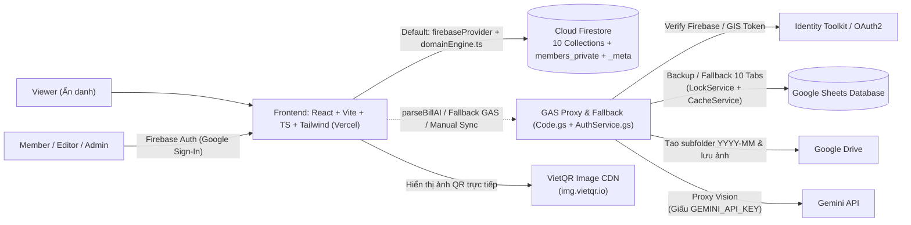

# SPEC.md — Hệ Thống Quản Lý Lịch Cầu Lông & Chia Tiền Ăn Nhậu

> **Vai trò tài liệu:** Nguồn chân lý duy nhất (Single Source of Truth) cho kiến trúc Hybrid (**Cloud Firestore** làm DB chính + **Google Sheets** 10 tabs sao lưu/dự phòng), phân quyền, bảo mật riêng tư (`members_private`), nghiệp vụ tính tiền tách biệt Cầu lông / Ăn nhậu (`Math.ceil` toàn dự án), hợp đồng API và giao diện Mobile-first của dự án.

---

## 1. Tổng quan & Mục tiêu dự án

### 1.1. Bối cảnh & Phạm vi sản phẩm
Dự án xây dựng một Web Application tối ưu cho thiết bị di động (**Mobile-first**) giúp câu lạc bộ cầu lông và hội ăn nhậu quản lý minh bạch, tách biệt rõ ràng hai dòng tiền:
- **Cầu lông (`BADMINTON`):**
  - Lập lịch tháng (`Schedule`) từ đầu tháng: tích ngày đánh, khung giờ, số sân, danh sách người chơi chính dự kiến; hỗ trợ điền nhanh khi tạo buổi thực tế.
  - Tính chi tiết chi phí từng buổi: `Tiền sân` (hỗ trợ nhiều dòng sân + **Sân thêm giờ**) + `Tiền cầu` (`số quả * đơn giá`) + `Chi phí khác`, cho phép tự động tính hoặc bật ghi đè nhập tay.
  - **Hóa đơn Cầu lông theo tháng (`Monthly_Bills` & `Monthly_Dues`):** Đầu tháng Thủ quỹ ước tính chi phí tháng (gợi ý từ lịch tháng) trừ đi phần dư/thâm hụt kỳ trước chuyển sang (`carry_in`), rồi chia đều cho thành viên chính (`MAIN`) tham gia tháng đó (`ceil` theo `rounding_unit = 1000`). Cuối tháng chốt chi phí thực tế (`actual_cost`) và cộng phần thu vãng lai (`guest_income`) để ra số dư chuyển kỳ sau (`carry_out`).
  - Khách vãng lai (`GUEST`) đóng phí theo buổi (`guest_fee`) trực tiếp cho Thủ quỹ (`treasurer_member_id`); **không tạo chuyển khoản chéo giữa các thành viên chính**.
- **Ăn nhậu (`DRINKING`):**
  - Hỗ trợ cả ăn ngoài quán (`RESTAURANT`) lẫn tụ tập ở nhà (`HOME`) có góp món (`Session_Items`: `BILL` | `ITEM`).
  - Tổng chi phí bàn nhậu bằng tổng các khoản `BILL` và `ITEM` (hoặc tổng hóa đơn nhập tay/AI); chia đều và **làm tròn lên (`Math.ceil`)** cho những người tham gia; tính `net_amount = per_person - contributed_amount` (`> 0` là phải trả thêm, `< 0` là được nhận lại), bù phần dư làm tròn về người góp nhiều nhất để người ứng tiền không bị hụt và $\sum \text{net\_amount} = 0$.
  - Thuật toán cấn trừ nợ vòng tròn (**Debt Simplification**) **chỉ chạy nội bộ trong nhóm Ăn nhậu**, không bao giờ trộn lẫn với công nợ Cầu lông.
- **Tích hợp AI (Gemini):** Bóc tách hóa đơn từ ảnh chụp (lưu ảnh trên Google Drive theo thư mục tháng `YYYY-MM`). Điểm danh sử dụng tick tay trực tiếp + tìm kiếm + thêm nhanh vãng lai (đã lược bỏ giọng nói).
- **Hiệu năng & Offline-tolerant:**
  - **Firestore Primary:** Query theo phạm vi (`fetchScopedDataset`), IndexedDB `persistentLocalCache`, 1 listener `onSnapshot` duy nhất trên `_meta/sync_state`.
  - **GAS Fallback & Cache:** API gộp `getAll` + request-scoped `_SHEET_CACHE_` + cắt gọn `sessions` trả về (6 tháng gần nhất + buổi còn `Attendance` chưa đóng để luôn dưới 95 KB `CacheService`) + cache `localStorage` Stale-While-Revalidate (`cln_swr_v6` kèm provider/tháng/kỳ) + lưu phiên đăng nhập (`cln_editor_session_v2`, `cln_my_member_id_v1`).
- **Định danh thành viên, Bảo mật riêng tư & Cảnh báo quá hạn:** `phone` và `email` được tách sang `members_private` trên Firestore (và strip khỏi mọi `doGet` GAS công khai) để Viewer không thấy PII. Thành viên thường đăng nhập Google (`verifyUser`) tự chọn tên mình để liên kết `email` (`linkMemberEmail`), lọc `"Chỉ xem của tôi"` hoặc xem `"Cả CLB (nhắc nhau)"` kèm cảnh báo quá hạn theo mốc 10 / 15 / 20 / 30+ ngày (`OverdueBadge`) và nút **Copy tin nhắn Zalo**.

### 1.2. Nguyên tắc thiết kế cốt lõi
1. **Viewer Zero-Friction & Privacy-by-Default:** Thành viên thường mở link là xem được ngay tổng quan, lịch cầu lông, lịch sử buổi chơi, công nợ tách riêng Cầu lông / Ăn nhậu, hóa đơn tháng và quét mã **VietQR** — **không cần đăng nhập**, và **không bao giờ thấy `phone`/`email`** của người khác. Khi đăng nhập Google (email đã xác minh) lần đầu, hệ thống hỏi tên thành viên để liên kết tài khoản.
2. **Tách biệt tuyệt đối Cầu lông & Ăn nhậu:** Công nợ Cầu lông (`Monthly_Dues`, `AD_HOC` và phí `GUEST`) luôn chuyển thẳng cho người thu (`treasurer_member_id` hoặc người ứng tiền `AD_HOC`). Công nợ Ăn nhậu chỉ đối soát chéo giữa các thành viên có phát sinh ăn nhậu.
3. **Hybrid Cloud Firestore (Chính) + Google Sheets (10 Tabs Backup/Fallback):** Dữ liệu vận hành chính trên Firestore (~50–250ms, real-time), đồng bộ 2 chiều theo yêu cầu với Google Sheets qua `exportRawTables`/`importRawTables`. Trên Sheet tự động format plain text (`@`) cho các cột ID, ngày, `phone`, `email`, `bank_bin`, `account_no`, `issued_at`.
4. **GAS làm Proxy AI/Drive & Fallback Backend:** Toàn bộ logic gửi ảnh Drive + gọi Gemini (`parseBillAI`) và chế độ fallback Google Sheets (`LockService`) đi qua Google Apps Script (`Code.gs`), hỗ trợ xác thực song song cả **Firebase ID Token** lẫn **GIS ID Token**.

---

## 2. Kiến trúc hệ thống & Cấu trúc thư mục

### 2.1. Sơ đồ kiến trúc tổng thể



### 2.2. Cấu trúc thư mục dự án

```text
caulong-nhau/
├── SPEC.md                          # Tài liệu đặc tả nguồn chân lý duy nhất
├── README.md                        # Hướng dẫn triển khai từ A-Z
├── docs/                            # FIREBASE_HYBRID_GUIDE.md, ROADMAP.md, CHANGELOG_AUDIT.md, adr/0001-firebase-hybrid.md
├── firebase/                        # firestore.rules, firestore.indexes.json
├── frontend/                        # Web App React + Vite + TypeScript + Tailwind (Deploy Vercel)
│   ├── public/                      # Static assets, icons (icon-192.png, icon-512.png, apple-touch-icon.png), manifest.json
│   └── src/
│       ├── components/              # Layout, VietQRModal, ReauthModal, EditorLoginButton, CardSkeleton...
│       ├── contexts/                # AuthContext (Firebase Auth + GIS fallback + localStorage), ToastContext
│       ├── hooks/                   # useClubData (SWR localStorage + Firestore onSnapshot)
│       ├── pages/                   # DashboardPage, CalendarPage, DebtsAndSessionsPage, MonthlyBadmintonPage, CreateSessionPage, SettingsPage
│       ├── services/                # api.ts (facade), providerRegistry.ts, domainEngine.ts (logic dùng chung),
│       │                            #   providers/ (firebase|gas|mock), firebase/config.ts, sync/manualSync.ts, mockData.ts
│       ├── types/                   # index.ts (khớp 100% Schema 10 bảng + members_private & API Contract)
│       └── utils/                   # badmintonCost.ts, monthlyBill.ts, drinkingSplit.ts, schedule.ts, debtSimplifier.ts, vietqr.ts, dateFilters.ts, imageCompress.ts, overdue.ts, zaloShare.ts, writeTracker.ts
└── gas-backend/                     # Google Apps Script REST API (AI Proxy + Sheets Sync + Fallback)
    ├── Code.gs                      # Entrypoint doGet (strip PII) / doPost + CacheService wrapper
    ├── AuthService.gs               # Verify song song Firebase ID Token & GIS ID Token + kiểm tra Editors
    ├── SheetService.gs              # Schema 10 tabs, CRUD, nghiệp vụ parity 1-1 với domainEngine.ts
    ├── DriveService.gs              # Upload ảnh hóa đơn vào subfolder YYYY-MM
    ├── GeminiService.gs             # Bóc tách ảnh hóa đơn (parseBillImage)
    └── DEPLOY_GAS.md                # Hướng dẫn deploy GAS chi tiết
```

### 2.3. Biến môi trường & Cấu hình

#### Frontend (`/frontend/.env`)
| Biến | Bắt buộc | Mô tả |
| :--- | :--- | :--- |
| `VITE_GAS_API_URL` | Có | URL Web App deployment của Google Apps Script (`https://script.google.com/macros/s/.../exec`) |
| `VITE_GOOGLE_CLIENT_ID` | Khi dùng GIS thuần | OAuth 2.0 Client ID (Web Application) dùng cho Google Identity Services khi chưa bật Firebase |
| `VITE_USE_MOCK` | Không | `true` = luôn chạy mock (bỏ qua `VITE_DB_PROVIDER`); production phải `false` |
| `VITE_DB_PROVIDER` | Không | `firebase` \| `gas` \| `mock`. Trống: tự chọn firebase → gas → mock theo cấu hình có sẵn. Admin có thể override cục bộ (`cln_db_provider_override_v1`) |
| `VITE_FIREBASE_API_KEY`, `_AUTH_DOMAIN`, `_PROJECT_ID`, `_STORAGE_BUCKET`, `_MESSAGING_SENDER_ID`, `_APP_ID` | Khi dùng Firebase | Cấu hình Firebase Web App |

> **Kiến trúc Hybrid:** Cloud Firestore (10 collection nghiệp vụ + `members_private` + `_meta/sync_state`) là DB chính khi `firebase`; Google Sheets (10 tabs) là nguồn gốc/backup/fallback, đồng bộ thủ công 2 chiều bởi `ADMIN` (`exportRawTables` / `importRawTables`). Logic nghiệp vụ dùng chung ở `services/domainEngine.ts`, song song với `SheetService.gs` — hai nơi phải luôn khớp 1–1. Ảnh hóa đơn & Gemini vẫn đi qua GAS.

#### GAS Backend (`PropertiesService.getScriptProperties()`)
| Property Key | Bắt buộc | Mô tả |
| :--- | :--- | :--- |
| `SPREADSHEET_ID` | Có (nếu standalone) | ID của Google Sheet chứa 10 tabs dữ liệu (không bắt buộc nếu GAS gắn trực tiếp với Sheet) |
| `ROOT_DRIVE_FOLDER_ID` | Có | ID thư mục gốc trên Google Drive dùng để tự động tạo subfolder `YYYY-MM` |
| `GEMINI_API_KEY` | Có | API Key của Google Gemini (chỉ lưu ở Script Properties, không lộ ra Frontend) |
| `GEMINI_MODEL` | Không | Tên model Gemini mặc định (VD: `gemini-2.5-flash`) |
| `GOOGLE_CLIENT_ID` | Có | Trùng với `VITE_GOOGLE_CLIENT_ID`, dùng xác minh trường `aud` của ID Token |
| `FIREBASE_WEB_API_KEY` | Khi dùng Firebase | Để GAS xác thực Firebase ID Token (`identitytoolkit accounts:lookup`); GAS nhận song song cả Firebase token và GIS token |

---

## 3. Phân quyền & Bảo mật (AuthN / AuthZ)

### 3.1. Ba vai trò người dùng
| Vai trò | Điều kiện truy cập | Quyền hạn |
| :--- | :--- | :--- |
| **Viewer** | Không cần đăng nhập | Xem `Tổng quan`, `Lịch` cầu lông & ăn nhậu, `Công nợ` tách riêng Cầu lông / Ăn nhậu + cảnh báo quá hạn + `Lịch sử buổi`, `Tháng cầu` (hóa đơn tháng & thống kê vãng lai), lọc `"Tôi là ai?"` (`localStorage`), Copy tin nhắn Zalo, mở **VietQR**. |
| **Member** | Đăng nhập Google (`verifyUser` trả `role = MEMBER`, `isEditor = false`) | Toàn bộ quyền Viewer + tự liên kết email của chính mình vào `members_private/{member_id}.email` trên Firestore (hoặc `Members.email` khi chạy fallback GAS) qua `MemberIdentityModal` (`linkMemberEmail`) để đồng bộ tên thành viên trên mọi thiết bị. |
| **Editor** | Đăng nhập Google + email nằm trong tab `Editors` (`is_active = TRUE`) | Toàn bộ quyền Viewer + Tạo/Sửa/Xóa buổi (`BADMINTON`, `DRINKING`), Chụp ảnh hóa đơn AI, Lập/Sửa lịch tháng (`Schedule`), Phát hành/Chốt hóa đơn tháng (`Monthly_Bills`), Xác nhận & Hoàn tác gạch nợ (`undoSettlement`), Quản lý `Members` và `Settings`. |

> **Phân cấp nội bộ trong tab `Editors`:**
> - `EDITOR`: Toàn quyền nghiệp vụ (buổi chơi, lịch, hóa đơn tháng, công nợ, thành viên, cài đặt).
> - `ADMIN`: Toàn quyền `EDITOR` + quản lý danh sách `Editors` (`manageEditors`).

### 3.2. Luồng xác thực (Firebase Auth / Google ID Token) & Lưu phiên `localStorage`
0. Khi Firebase được cấu hình: đăng nhập bằng Firebase Auth (Google Sign-In), token tự gia hạn; Firestore Security Rules (`firebase/firestore.rules`) kiểm tra quyền qua `editors/{email}`. Token Firebase cũng được gửi sang GAS (`parseBillAI`, sync). Khi chỉ dùng GAS: dùng Google Identity Services như mô tả dưới.
1. Frontend lưu phiên tại `localStorage` (`cln_editor_session_v2`, `cln_editor_profile_v2`, `cln_my_member_id_v1`) để người dùng đóng/mở lại trình duyệt trên điện thoại vẫn giữ trạng thái đăng nhập nhanh.
2. Khi token sắp hết hạn hoặc API trả `UNAUTHORIZED`, Frontend tự thử làm mới thầm lặng qua Google Identity Services (`auto_select: true` / One Tap). Nếu không thể làm mới thầm lặng, mở `ReauthModal` để đăng nhập lại 1 chạm mà **không xóa dữ liệu form đang nhập**.
3. Backend `AuthService.gs` kiểm tra `idToken` qua `tokeninfo` (`verifyGoogleJwt_` / `verifyUserToken`), xác minh `aud`, `email_verified`, `exp`, đối chiếu `email` trong tab `Editors` (`is_active = TRUE`) hoặc tìm `linkedMemberId` qua `Members.email`; mọi hành động ghi admin/editor đều kiểm tra `if (!auth.isEditor)` (`403 FORBIDDEN`) và bọc trong `LockService.getScriptLock().waitLock(10000)`.
4. Sau mỗi thao tác ghi thành công, Backend gọi `bumpCacheVersion_()` và `invalidateSheetCache_()` để vô hiệu cache ngay lập tức.

---

## 4. Quy tắc nghiệp vụ chi tiết (Business Logic)

### 4.1. Luồng Cầu lông (`BADMINTON`)

#### A. Chi phí từng buổi Cầu lông (Buổi cố định 0đ + Vãng lai + Sân thêm giờ vs Buổi phát sinh)
- **Buổi đánh theo lịch cố định (`billing_mode = MONTHLY`):**
  - Do tiền sân & hộp cầu cố định đã thu từ đầu tháng qua hóa đơn tháng, khi bấm **Điểm danh & Ghi buổi** sẽ **không phát sinh tiền buổi** (`total_amount = 0` mặc định, thành viên `MAIN` có `fee_amount = 0`, `is_paid = TRUE`).
  - Chỉ tính phí **Vãng lai theo buổi** (`guest_fee`, mặc định `50000đ` cho khách `GUEST`) và **Sân thêm giờ** (tùy chọn, mặc định `0đ`, cộng thêm khi buổi đó đông phải thuê thêm sân/giờ — phần thêm giờ này sẽ được tự động tổng hợp làm gợi ý `suggestedPrevOvertime` cho hóa đơn đầu tháng kế tiếp).
- **Buổi cầu phát sinh ngoài lịch (`billing_mode = AD_HOC`):**
  - Tính đầy đủ chi phí buổi: **Tiền sân** (`courtLines[]`: `số sân * số giờ * giá/giờ`, hỗ trợ thêm nhiều dòng Sân thêm giờ) + **Tiền cầu** (`shuttle_qty * shuttlePrice`) + **Chi phí khác** (`other_amount`), hỗ trợ ghi đè nhập tay độc lập cho `courtOverride`, `shuttleOverride`, `totalOverride`.
- Khi ghi buổi Cầu lông (`createSession` / `updateSession`): **không tạo khoản hoàn ứng chéo giữa các thành viên chính**. Nếu tạo buổi cố định từ ngoài trang Lịch trùng ngày `Schedule` còn mở (`!= CANCELLED`), hệ thống tự động khớp `plan_id` và chuyển lịch ngày đó sang `DONE`. *(Lưu ý: tab `Fund_Ledger` cũ đã ngừng sử dụng ở v2.4).*

#### B. Lập lịch Cầu lông theo tháng (`Schedule`) & Giờ hệ thống `Asia/Ho_Chi_Minh`
- Toàn bộ hiển thị ngày/giờ hiện tại trên Frontend (`getNowVN`, `getTodayDateStr`, `formatTimeVN`, `Date.UTC` tính thứ) và Backend (`Utilities.formatDate(..., 'Asia/Ho_Chi_Minh', ...)`) chuẩn hóa theo múi giờ Việt Nam (`Asia/Ho_Chi_Minh`).
- Đầu tháng (hoặc giữa tháng với tùy chọn *"Chỉ tạo từ hôm nay trở đi"*), Editor dùng **Tạo lịch tháng** (`generateSchedule`): tự động khớp `DONE` với những ngày đã có buổi cầu cố định trong `Sessions`. Hỗ trợ thêm/sửa/nghỉ-hủy (`CANCELLED`)/khôi phục/đánh dấu hoàn thành từng ngày lẻ (`updateScheduleDay`).
- Giao diện Lịch xác định **5 trạng thái hiệu lực** theo giờ Việt Nam (`getEffectiveScheduleStatus`):
  1. `DONE` (**Đã diễn ra** — đã điểm danh hoặc đánh dấu hoàn thành).
  2. `CANCELLED` (**Đã hủy / Nghỉ** — gạch ngang, loại khỏi ước tính tiền sân).
  3. `PAST_UNLOGGED` (**Đã qua — chưa ghi buổi** — quá ngày hoặc quá giờ kết thúc `end_time` trong ngày).
  4. `ONGOING` (**Đang diễn ra** — trong khung giờ `start_time`–`end_time` hôm nay).
  5. `UPCOMING` (**Sắp diễn ra**).
- Cả ngày có lịch cố định vẫn bấm tạo thêm **`+ Buổi cầu phát sinh`** (`AD_HOC`) hoặc **`+ Buổi nhậu`** được ngay trên ngày đang chọn.

#### C. Hóa đơn Cầu lông theo tháng (`Monthly_Bills` & `Monthly_Dues`) — Thay cho quỹ cố định cũ
1. **Phát hành đầu tháng (`issueMonthlyBill`):**
   - Hỗ trợ tách chi tiết theo báo giá chủ sân: `Tổng hóa đơn chủ sân = Tiền sân (court_fee) + (Số ống cầu * Giá/ống) + Tiền thêm giờ tháng trước (prev_overtime_fee)`. Editor có thể sửa tay toàn bộ từng ô (kể cả ghi đè tổng tiền theo con số chủ sân đưa ra hoặc sửa tay `carry_in`).
   - **Đồng bộ danh sách thành viên (`syncMemberTypes = true`):** Khi phát hành hóa đơn tháng, giao diện hiển thị toàn bộ thành viên đang hoạt động (`MAIN` + `GUEST`); người được tích tự động cập nhật thành `MAIN` (Thành viên chính), người không được tích tự động chuyển sang `GUEST` (Vãng lai) trên tab `Members` (không làm thay đổi `Attendance.member_type_snapshot` lịch sử).
   - **Đặt lịch cầu lông tùy chọn (`scheduleConfig`, không bắt buộc):** Có thể tích chọn đặt lịch đánh cố định tháng ngay trong hộp thoại phát hành hóa đơn (thứ trong tuần, giờ chơi, số sân, tùy chọn từ hôm nay trở đi), đồng thời gán danh sách `MAIN` mới vào các ngày `PLANNED` trong tháng.
   - `carry_in`: Lấy từ `carry_out` của tháng trước (`0` nếu tháng trước chưa có).
   - **Khấu trừ người góp ống cầu tháng trước (`appliedCredits`):**
     - Trong tháng, Editor ghi nhận ai mua/góp bao nhiêu ống cầu với giá riêng tự nhập (`saveMonthlyContributions` lưu JSON trong `Monthly_Bills.shuttle_contributions`).
     - Khi phát hành hóa đơn đầu tháng sau, hệ thống tự nạp các khoản góp cầu từ tháng trước để tính:
       $$\text{grossToDistribute} = \max(0, \text{estimate} + \text{appliedCreditsTotal} - \text{carry\_in})$$
       $$\text{per\_member} = \text{Math.ceil}\left(\frac{\text{grossToDistribute}}{\text{member\_count} \times \text{unit}}\right) \times \text{unit}$$
       $$\text{netDue}[m] = \max(0, \text{per\_member} - \text{creditAmount}[m])$$
     - `billed_total = sum(netDue[m])` (tổng tiền mặt thực thu về tay Thủ quỹ), và phần dư khi `credit_amount > per_member` (`remainingCredit`) được tự động lưu vào `Monthly_Bills.carry_over_credits` để gộp sang tháng tiếp theo trừ tiếp.
     - Sinh các dòng trong `Monthly_Dues` với `amount = netDue`, `base_amount = per_member`, `credit_amount`, `credit_note`, `issued_at` (tự động `is_paid = TRUE` nếu `netDue === 0`).
2. **Khách vãng lai (`GUEST`) đi đánh Cầu lông:**
   - Khi điểm danh buổi `BADMINTON`, thành viên `MAIN` có `fee_amount = 0`, `is_paid = TRUE`.
   - Thành viên `GUEST` có `fee_amount = session.guest_fee`, `creditor_id = treasurer_member_id`, `net_amount = fee_amount` (hoặc `0` nếu tích *"Đã đóng ngay"*).
   - Toàn bộ tiền vãng lai đã thu trong tháng cộng vào `guest_income` của tháng đó.
3. **Chốt tháng & Dự kiến đầu tháng (`closeMonth`):**
   - `actual_cost`: Khi tháng đang `OPEN`, chưa nhập `actual_cost_override` và tổng các buổi đã nhập (`logged_sessions_cost`) nhỏ hơn `estimate` chủ sân, hệ thống tạm dùng `estimate` (`is_projected_cost = true`) để tránh dư ảo đầu tháng; khi đã ghi đủ buổi hoặc chốt tháng (`actual_cost_override`), dùng chi phí thực tế.
   - **Số dư chuyển sang tháng sau (`carry_out`):**
     $$\text{carry\_out} = \text{carry\_in} + \text{billed\_total} + \text{guest\_income} - \text{actual\_cost}$$
   - Số `carry_out` này sẽ tự động trở thành `carry_in` của tháng tiếp theo, giúp tiền vãng lai và phần dư/thiếu tháng trước tự động bù trừ công bằng vào tiền mỗi người phải đóng tháng sau.

#### D. Buổi cầu phát sinh ngoài lịch cố định (`billing_mode = AD_HOC`)
- Khi đánh thêm một buổi cầu không thuộc lịch cố định tháng (VD: buổi đánh phát sinh cuối tuần / thứ khác), Editor tick chọn **`Buổi cầu phát sinh (ngoài lịch cố định)`**.
- **Cách chia tiền:** Lấy tổng chi phí buổi (`total_amount`) chia đều cho **tất cả người tham gia** (`attendee_count`, bao gồm cả `MAIN` và `GUEST`), làm tròn lên theo `unit = rounding_unit` (`1000`):
  $$\text{per\_person\_amount} = \text{Math.ceil}\left(\frac{\text{total\_amount}}{\text{attendee\_count} \times \text{unit}}\right) \times \text{unit}$$
- **Người nhận tiền (`payer_id`):** Mặc định là Thủ quỹ, cho phép đổi sang thành viên khác nếu người đó ứng tiền. Người ứng tiền tự động `is_paid = TRUE`, các thành viên còn lại ghi nợ chuyển thẳng cho `payer_id` (nhận VietQR theo tài khoản của `payer_id`).
- **Tách bạch với hóa đơn tháng:** Buổi cầu `AD_HOC` **không** cộng vào `Monthly_Bills.actual_cost` và tiền `GUEST` của buổi đó **không** cộng vào `Monthly_Bills.guest_income` (tránh tính trùng vì đã chia và thu trực tiếp ở buổi phát sinh).

---

### 4.2. Luồng Ăn nhậu (`DRINKING`) & Góp món (`Session_Items`)
- Hỗ trợ 2 hình thức địa điểm (`venue_type`):
  - **`RESTAURANT` (Ra quán):** Có hóa đơn tổng (hoặc nhiều hóa đơn / món phụ), mặc định có người trả chính (`payer_id`), có thể bổ sung các khoản góp thêm của thành viên khác.
  - **`HOME` (Tại nhà):** Mọi người tới góp món (`ITEM`) — ai mua gì khai báo `{ member_id, kind: 'ITEM', item_name, amount }`.
- **Công thức tính chia tiền (`calculateDrinkingSplit`):**
  1. Tổng chi phí bàn nhậu `total_amount` = tổng `Session_Items.amount` (nếu có khai báo `items`), hoặc `payload.totalAmount` nếu không tách dòng item (tự tạo 1 dòng `BILL` cho `payer_id`).
  2. Mỗi người có `contributed_amount` = tổng `amount` các dòng `Session_Items` của người đó.
  3. Chia đều cho `attendee_count` người tham gia, **làm tròn lên** (`Math.ceil`) theo `rounding_unit`:
     `per_person = Math.ceil(total_amount / attendee_count / unit) * unit`
  4. `net_amount = per_person - contributed_amount`:
     - Phần dư làm tròn (luôn khiến $\sum \text{net\_amount} \ge 0$ trước khi bù) được cộng về người góp nhiều nhất (ưu tiên `payer_id` nếu bằng nhau) để **người ứng tiền không bị hụt** và **luôn giữ bất biến** $\sum \text{net\_amount} = 0$.
     - Nếu `net_amount > 0`: thành viên **phải trả thêm** số tiền này (`is_paid = FALSE`).
     - Nếu `net_amount < 0`: thành viên **được nhận lại** `|net_amount|` (`is_paid = FALSE` cho tới khi các bên thanh toán).
     - Nếu `net_amount === 0`: tự động đánh dấu `is_paid = TRUE`.

---

### 4.3. Tách biệt Công nợ Cầu lông & Ăn nhậu

1. **Công nợ Cầu lông (`debts.badminton`):**
   - Gồm 3 danh sách (tách biệt hoàn toàn với Ăn nhậu):
     - `monthlyDues`: Các dòng `Monthly_Dues` chưa đóng (`is_paid = FALSE`) của thành viên `MAIN` -> **chuyển thẳng cho Thủ quỹ**.
     - `adhocDues`: Các dòng `Attendance` của buổi cầu phát sinh (`billing_mode = AD_HOC`, `is_paid = FALSE`, gồm cả `MAIN` và `GUEST`) -> **chuyển thẳng cho người ứng tiền (`creditor_id`)**.
     - `guestDues`: Các dòng `Attendance` của buổi cầu cố định (`billing_mode = MONTHLY`, `member_type_snapshot = GUEST`, `is_paid = FALSE`) -> **chuyển thẳng cho Thủ quỹ**.
   - Mỗi khoản có sẵn `transferContent` và `vietQrUrl` hướng về tài khoản người nhận tương ứng.
   - Editor xác nhận thu bằng `markDuePaid` (cho `Monthly_Dues`) hoặc `confirmPayment` (`category: 'BADMINTON'`, `mode: 'ITEMS'`) cho `guestDues` và `adhocDues`.
2. **Công nợ Ăn nhậu (`debts.drinking`):**
   - Chỉ tổng hợp từ các `Attendance` có `session_type = 'DRINKING'`, `is_paid = FALSE` và các `Settlements` có `category = 'DRINKING'`, `is_reconciled = FALSE`.
   - Tính `netBalance[member]`: trừ `net_amount` (`net_amount > 0` là nợ -> balance âm; `net_amount < 0` là được nhận -> balance dương), cộng trừ bù trừ với `Settlements` chưa `is_reconciled`.
   - Chạy Greedy Debt Simplification để tạo danh sách chuyển khoản tối ưu `simplifiedTransfers` + link **VietQR**.
   - Editor xác nhận thanh toán qua `confirmPayment` (`category: 'DRINKING'`, `mode: 'SIMPLIFIED_TRANSFER'` hoặc `'ITEMS'`); khi tổng `|balance|` của các bên về `0`, tự động tất toán (`is_paid = TRUE`, `is_reconciled = TRUE`).

---

## 5. Tính năng AI & Ảnh hóa đơn (Gemini + Google Drive)

- Toàn bộ lệnh gọi Gemini chạy ở GAS (`GeminiService.gs`) để bảo vệ `GEMINI_API_KEY`.
- Trước khi upload từ Frontend (`utils/imageCompress.ts`), ảnh được nén ở client (Canvas resize + JPEG) để payload nhẹ.
- Backend (`DriveService.gs` + `GeminiService.gs`) lưu ảnh vào subfolder `YYYY-MM` trong `ROOT_DRIVE_FOLDER_ID`, bật quyền xem `ANYONE_WITH_LINK`, và trả về `receipt_drive_id`, `receipt_url`, `total_amount`, `items_summary`, `suggested_title`.
- **Lưu ý:** Tính năng điểm danh bằng giọng nói đã được gỡ bỏ hoàn toàn khỏi cả Frontend và Backend để tối ưu sự gọn nhẹ, tập trung vào tick tay + thêm nhanh vãng lai.

---

## 6. Database Schema (10 Bảng Nghiệp Vụ + `members_private` + `_meta`)

Quy ước chung:
- **Primary DB (Firestore):** 10 collection nghiệp vụ + `members_private/{member_id}` (lưu `phone`, `email` tách riêng khỏi `members`) + `_meta/sync_state` (`dataRevision` real-time). Security Rules chuẩn tại [firebase/firestore.rules](./firebase/firestore.rules).
- **Google Sheets (10 tabs backup/fallback):** Dòng 1 là Header chính xác theo tên cột bên dưới. Toàn bộ cột ID, ngày `YYYY-MM-DD`, tháng `YYYY-MM`, `phone`, `bank_bin`, `account_no`, `email`, `issued_at` được hàm `setupDatabase()` đặt định dạng plain text (`@`) và đọc qua `normalizeCellValue_()` để không bao giờ bị mất số `0` đầu hay chuyển thành số khoa học (`E+`). Tab `Fund_Ledger` cũ nếu còn trên Sheet được giữ nguyên làm kho lưu trữ lịch sử, app không đọc/ghi.

### 6.1. Tab `Members` & Firestore `members` / `members_private`
- **Google Sheet (`Members`):** `member_id`, `name`, `aliases`, `type` (`MAIN` | `GUEST`), `phone`, `email`, `bank_bin`, `bank_name`, `account_no`, `account_name`, `is_active`, `created_at`, `updated_at`
- **Firestore `members/{member_id}` (Công khai cho App & VietQR):** `member_id`, `name`, `aliases`, `type`, `bank_bin`, `bank_name`, `account_no`, `account_name`, `has_email`, `is_active`, `created_at`, `updated_at` *(KHÔNG chứa `phone`/`email`)*.
- **Firestore `members_private/{member_id}` (Riêng tư — chỉ Editor hoặc chính chủ):** `member_id`, `phone`, `email`, `updated_at`.
- **GAS `doGet` công khai:** luôn trả `phone: ""`, `email: ""`, `has_email: boolean`. Editor đọc dữ liệu riêng tư qua `POST getMembersPrivate`.

### 6.2. Tab `Sessions`
`session_id`, `date`, `type` (`BADMINTON` | `DRINKING`), `title`, `total_amount`, `guest_fee`, `payer_id`, `per_person_amount`, `attendee_count`, `receipt_drive_id`, `receipt_url`, `receipt_summary`, `note`, `court_amount`, `shuttle_qty`, `shuttle_amount`, `other_amount`, `cost_detail` (JSON), `venue_type` (`RESTAURANT` | `HOME` | `""`), `plan_id`, `billing_mode` (`MONTHLY` | `AD_HOC` | `""`), `created_by`, `created_at`, `updated_at`

### 6.3. Tab `Attendance`
`attendance_id`, `session_id`, `session_date`, `session_type`, `member_id`, `member_type_snapshot`, `fee_amount`, `creditor_id`, `contributed_amount`, `net_amount`, `is_paid`, `paid_at`, `settlement_id`, `note`

### 6.4. Tab `Session_Items` (Góp món / Hóa đơn buổi Ăn nhậu)
`item_id`, `session_id`, `member_id`, `kind` (`BILL` | `ITEM`), `item_name`, `amount`

### 6.5. Tab `Schedule` (Lịch đánh cầu lông tháng)
`plan_id`, `date` (`YYYY-MM-DD`), `start_time` (`HH:mm`), `end_time` (`HH:mm`), `courts`, `planned_member_ids` (comma-separated), `status` (`PLANNED` | `DONE` | `CANCELLED`), `session_id`, `note`, `created_at`, `updated_at`

### 6.6. Tab `Monthly_Bills` (Hóa đơn Cầu lông hàng tháng)
`month` (`YYYY-MM`), `estimate`, `carry_in`, `to_collect`, `member_count`, `per_member`, `billed_total`, `actual_cost`, `actual_cost_override`, `guest_income`, `carry_out`, `status` (`OPEN` | `CLOSED`), `created_by`, `closed_at`, `updated_at`, `court_fee`, `shuttle_tube_qty`, `shuttle_tube_price`, `shuttle_tube_amount`, `prev_overtime_fee`, `bill_detail` (JSON), `shuttle_contributions` (JSON), `applied_credits_total`, `carry_over_credits` (JSON)

### 6.7. Tab `Monthly_Dues` (Khoản đóng tiền cầu theo tháng của từng `MAIN`)
`due_id`, `month` (`YYYY-MM`), `member_id`, `amount`, `is_paid`, `paid_at`, `confirmed_by`, `base_amount`, `credit_amount`, `credit_note`, `issued_at`

### 6.8. Tab `Settlements` (Lịch sử gạch nợ)
`settlement_id`, `from_member_id`, `to_member_id`, `amount`, `settled_at`, `method`, `category` (`BADMINTON` | `DRINKING`), `source_attendance_ids`, `source_ledger_ids`, `is_reconciled`, `transfer_content`, `note`, `confirmed_by`

### 6.9. Tab `Settings`
Cấu hình các khóa mặc định:

| `key` | Giá trị mặc định | Mô tả |
| :--- | :--- | :--- |
| `club_name` | `CLB Cầu Lông & Nhậu` | Tên hiển thị trên tiêu đề Web App |
| `treasurer_member_id` | `""` (điền `MEM_001`) | `member_id` của Thủ quỹ |
| `guest_fee` | `50000` | Phí vãng lai mặc định mỗi buổi cầu lông (VND) |
| `court_price_per_hour` | `0` | Giá thuê 1 sân / 1 giờ mặc định (VND) |
| `shuttle_price` | `0` | Giá mỗi quả cầu mặc định (VND) |
| `default_court_count` | `2` | Số sân mặc định khi lập lịch / tạo buổi |
| `default_play_hours` | `1.5` | Số giờ chơi mặc định mỗi buổi |
| `drive_folder_id` | `""` | Ghi chú Folder ID Drive (tùy chọn) |
| `rounding_unit` | `1000` | Bội số làm tròn khi chia tiền (VND) |
| `vietqr_template` | `compact2` | Template VietQR (`compact`, `compact2`, `qr_only`, `print`) |
| `transfer_prefix` | `CLN` | Tiền tố nội dung chuyển khoản VietQR |

### 6.10. Tab `Editors`
`email`, `name`, `role` (`ADMIN` | `EDITOR`), `is_active`, `added_at`

---

## 7. API Contract (Frontend <-> Google Apps Script)

- **Read (`GET`):** Trả về `{ ok, data, meta: { timestamp }, error }`.
  - `ping`: Healthcheck nhẹ (`{ pong: true, ts }`).
  - `getAll&periodType=MONTH&refDate=...&month=YYYY-MM`: **Endpoint gộp chính**, trả về `{ bootstrap, dashboard, sessions, debts, schedule, monthlyBill, guestStats }`, được cache trong `CacheService` 300 giây theo version.
  - Các endpoint lẻ vẫn giữ để tương thích / tải chi tiết: `bootstrap`, `getDashboard`, `getMembers`, `getSessions`, `getSessionDetail`, `getSettings`, `getGuestStats`, `getDebts`, `getSchedule`, `getMonthlyBill`.
- **Write / Auth / AI (`POST` với `Content-Type: text/plain;charset=utf-8`, body `{ action, idToken, payload }`):**
  - Auth & Editors: `verifyUser` (alias `verifyEditor`), `linkMemberEmail` (mọi user đã đăng nhập Google), `getEditors`, `manageEditors` (`ADMIN`).
  - Buổi chơi: `createSession`, `updateSession`, `deleteSession`.
  - Thanh toán: `confirmPayment` (alias `confirmSettlement`), `undoSettlement`.
  - Lịch tháng: `generateSchedule`, `updateScheduleDay`.
  - Hóa đơn Cầu lông tháng: `issueMonthlyBill`, `saveMonthlyContributions`, `markDuePaid`, `closeMonth`.
  - Thành viên & Cài đặt: `upsertMember`, `getMembersPrivate` (`Editor`), `updateSettings`.
  - AI Hóa đơn: `parseBillAI` (alias `parseReceipt`).
  - Đồng bộ Sheet ↔ Firebase (`ADMIN`): `exportRawTables`, `importRawTables` (10 bảng).

> **Quy tắc làm tròn (`Math.ceil` toàn dự án):** Toàn bộ phép chia tiền (hóa đơn cầu lông tháng, buổi cầu phát sinh `AD_HOC`, và chia tiền Ăn nhậu) đều dùng `Math.ceil` theo `rounding_unit` để người ứng tiền không bao giờ bị hụt; riêng Ăn nhậu cộng bù phần dư về người góp nhiều nhất (ưu tiên `payer_id` nếu hòa) để $\sum \text{net\_amount} = 0$.
> **Tái dùng cột:** `Settlements.source_ledger_ids` dạng `REC:SET_1,SET_2` lưu các đợt chốt `SIMPLIFIED_TRANSFER` đã đối soát (không thêm trường mới).
> **Quy tắc nghiệp vụ đã chốt (chi tiết tại [docs/CHANGELOG_AUDIT.md](./docs/CHANGELOG_AUDIT.md)):**
> - **A1 (Vãng lai):** Tính vào quỹ tháng theo ngày thực thu (`paid_at`); tab Thống kê Vãng lai hiển thị rõ cả *Phát sinh theo buổi* lẫn *Thực thu tính quỹ tháng*.
> - **A2 (Hoàn góp cầu cho người không đánh `MAIN`):** Chia toàn bộ tiền góp vào tổng `MAIN`, sinh mục `refundCredits` (Thủ quỹ hoàn riêng) và trừ khỏi `carry_out`.
> - **A3 (`Sân thêm giờ`):** Tháng `OPEN` tính theo `estimate` chủ sân; toàn bộ `Sân thêm giờ` dồn sang `prevOvertimeFee` tháng kế tiếp.
> - **A4 (Sửa buổi đã có `settlement_id`):** Chỉ cho sửa *Tiêu đề, Ghi chú, Ảnh hóa đơn*; khóa số tiền, ngày, người trả, người tham gia và món góp.
> - **A5 (Buổi rơi vào tháng `CLOSED`):** Hiện cảnh báo xác nhận trước khi lưu, không chặn cứng.
> - **Dashboard không đếm trùng:** Tháng đã phát hành/chốt hóa đơn chỉ tính `monthlyBill.actual_cost` (không cộng lại `total_amount` của các buổi `MONTHLY`).
> - **`Monthly_Dues.issued_at`:** Lưu cố định ngày phát hành để không bị reset số ngày quá hạn khi ghi góp ống cầu giữa tháng.

---

## 8. Cấu trúc màn hình & Quy tắc cảnh báo quá hạn (Mobile-first UI + React Router)

### 8.1. Cảnh báo quá hạn (`utils/overdue.ts` & `OverdueBadge`)
- Mốc tính từ `issued_at` (hóa đơn tháng) hoặc `session_date` (vãng lai / phát sinh / buổi nhậu lâu nhất chưa thanh toán):
  - `10–14 ngày`: Badge vàng (`⏰ Quá X ngày`).
  - `15–19 ngày`: Badge cam + viền nổi bật (`⚠️ Quá X ngày`).
  - `20–29 ngày`: Badge đỏ nhấp nháy `animate-pulse` (`🔥 Quá X ngày`).
  - `>= 30 ngày`: Badge đỏ thẫm nhấp nháy `animate-pulse` (`🚨 Quá 1 tháng (X ngày)`).

### 8.2. Các Route màn hình (`react-router-dom`)
| Route / Tab | Vai trò xem | Chức năng chính |
| :--- | :--- | :--- |
| `/` (**Tổng quan**) | Viewer, Member, Editor | Thanh thao tác nhanh Editor (`+ Thêm buổi Cầu lông` / `+ Thêm buổi Ăn nhậu`); 4 thẻ KPI (`Chi Cầu lông`, `Chi Ăn nhậu`, `Bù trừ Cầu tháng` kèm nút xem công thức giải thích, `Nợ chưa thu`); Bộ lọc `"Tôi là ai?"` + `"Chỉ xem của tôi"` / `"Cả CLB (nhắc nhau)"`; Cảnh báo quá hạn & VietQR; Biểu đồ & 5 buổi gần nhất. |
| `/calendar` (**Lịch**) | Viewer, Member, Editor | Lịch tháng chuẩn giờ VN (`Asia/Ho_Chi_Minh`) với 5 trạng thái (`Đã diễn ra`, `Đang diễn ra`, `Sắp diễn ra`, `Qua ngày chưa ghi`, `Nghỉ/Hủy`), thanh tóm tắt tháng, nút `Hôm nay`, tạo lịch tháng (có tùy chọn từ hôm nay), thêm/sửa/hủy/khôi phục ngày lẻ, bấm **"Điểm danh & Ghi buổi"**, **"+ Buổi cầu phát sinh"**, hoặc sửa buổi thực tế trong ngày. |
| `/debts` (**Công nợ**) | Viewer, Member, Editor | Bộ lọc `"Tôi là ai?"` + `"Copy tin nhắn nhắc nợ Zalo"`; Tab `1. Tiền Cầu lông` (Tháng cầu `MAIN`, Phát sinh & Vãng lai -> VietQR) & `2. Tiền Ăn nhậu` (Chuyển khoản tối ưu nội bộ + breakdown từng buổi + VietQR); Lịch sử đã thu kèm nút **Hoàn tác** (`undoSettlement`); Tab `Lịch sử buổi`. |
| `/monthly` (**Tháng cầu**) | Viewer, Member, Editor | Công thức minh bạch, nút **Copy báo thu Zalo**, góp ống cầu trong tháng, danh sách `MAIN` kèm cảnh báo quá hạn & VietQR; tự động gợi ý `suggestedPrevOvertime` từ các dòng Sân thêm giờ tháng trước; Tab thống kê `Vãng lai theo tháng`. |
| `/create` (**Ghi buổi**) | Editor | Tạo/Sửa buổi `BADMINTON` cố định (0đ mặc định, thu Vãng lai `50.000đ` + tùy chọn **Sân thêm giờ**), `BADMINTON` phát sinh (`Sân + Cầu + Khác`, ghi đè tay) hoặc `DRINKING` (`RESTAURANT`/`HOME` + `Session_Items` góp món); Quét ảnh bill AI dùng chung; Tick tay + tìm kiếm + thêm nhanh vãng lai. |
| `/settings` (**Cài đặt**) | Editor | Cấu hình `Settings`, quản lý `Members` và `Editors` (`ADMIN`); tab **Database & Đồng bộ** (`ADMIN`): chọn nguồn dữ liệu cục bộ, so sánh số bản ghi, Pull Sheet→Firebase, Push Firebase→Sheet. |
