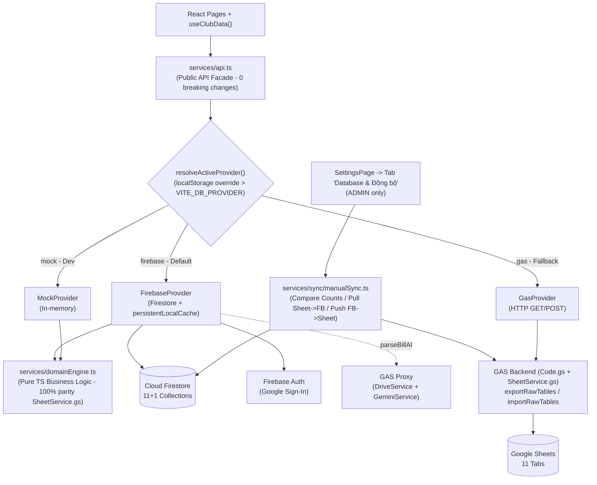

# MASTER PLAN: Chuyển Đổi Database Sang Firebase (Kiến Trúc Hybrid Linh Hoạt)

> Tài liệu này là bản thiết kế kỹ thuật chuẩn (Blueprint) cho việc chuyển đổi database của ứng dụng **CLB Cầu Lông & Nhậu** từ Google Sheets + Google Apps Script (GAS) sang **Cloud Firestore + Firebase Auth**, kết hợp mô hình **Hybrid** linh hoạt chuyển nguồn và đồng bộ 2 chiều với Google Sheets.

---

## 1. Các Quyết Định Kiến Trúc Đã Chốt (ADR)

| Hạng mục | Quyết định đã chốt |
| :--- | :--- |
| **Database chính (Production)** | **Cloud Firestore** (gói miễn phí **Spark**, \$0/tháng, không cần thẻ tín dụng). |
| **Đồng bộ Google Sheets** | **Manual Push / Pull 2 chiều theo yêu cầu** bởi `ADMIN` trong tab Cài đặt (không chạy auto-mirror ngầm trên mỗi thao tác ghi → giữ code gọn, không tốn quota GAS, không phát sinh xung đột ghi ngầm). |
| **Ảnh hóa đơn & Gemini OCR (`parseBillAI`)** | **Giữ nguyên GAS** ([DriveService.gs](../gas-backend/DriveService.gs) + [GeminiService.gs](../gas-backend/GeminiService.gs)) làm proxy miễn phí, giữ nguyên kho ảnh Google Drive phân thư mục `YYYY-MM`. |
| **Chuyển đổi kết nối** | Cấu hình mặc định qua biến môi trường `VITE_DB_PROVIDER` (`firebase` \| `gas` \| `mock`) + **Admin Runtime Switcher** lưu override ở `localStorage` để chuyển nóng giữa **Firebase ↔ Google Sheets** (kiểm tra đối chiếu hoặc fallback khẩn cấp) ngay trên giao diện `SettingsPage`. |
| **Xác thực (Auth)** | **Firebase Auth (Google Sign-In)** tự gia hạn token (hết cảnh hết hạn 1 giờ). Nâng cấp [AuthService.gs](../gas-backend/AuthService.gs) nhận **song song cả Firebase ID Token lẫn GIS ID Token cũ** → đăng nhập 1 lần dùng chung cho cả Firestore, `parseBillAI` và Sync Google Sheets. |

---

## 2. So Sánh 3 Mô Hình & Sơ Đồ Kiến Trúc Tổng Thể

### So sánh 3 mô hình

| Tiêu chí | Chỉ GAS + Sheets (Hiện tại) | Chỉ Firebase (Firestore + Auth) | Hybrid (Đang thiết kế) |
| :--- | :--- | :--- | :--- |
| **Tốc độ đọc / ghi** | 1.5s – 5s | **50ms – 250ms** | **50ms – 250ms** (Firebase làm Primary) |
| **Real-time** | Không (phải F5 / Làm mới) | Có (`onSnapshot`) | Có (khi Primary = Firebase) |
| **Xem/sao lưu trên Excel/Sheets** | Trực tiếp | Phải tự export CSV | **Giữ nguyên Google Sheet** làm bản sao dự phòng & đối soát theo nút bấm |
| **Phiên đăng nhập** | Hết hạn sau 1h (GIS JWT) | Tự gia hạn (Firebase Auth) | Tự gia hạn (1 lần đăng nhập dùng cho cả Firestore & GAS) |
| **Quét hóa đơn AI & Lưu ảnh** | [DriveService.gs](../gas-backend/DriveService.gs) + [GeminiService.gs](../gas-backend/GeminiService.gs) | Cần Vercel API hoặc Firebase Blaze | **Tái sử dụng GAS `parseBillAI` (\$0)** |
| **Dự phòng (Fallback)** | Phụ thuộc GAS | Phụ thuộc Firebase | **Đổi nóng qua lại** giữa Firebase ↔ Google Sheet |

### Sơ đồ kiến trúc tổng thể



---

## 3. Thiết Kế Cloud Firestore, Tối Ưu Quota & Bảo Mật

### 3.1. Ánh xạ 1:1 với 11 Tabs Google Sheets
Giữ nguyên tên field `snake_case` của [types/index.ts](../frontend/src/types/index.ts) và dùng đúng khóa chính hiện có làm **Document ID** (đảm bảo idempotent khi Pull/Push nhiều lần):

| Firestore Collection | Document ID | Tab Sheet gốc | Trường bổ sung / Index cần thiết |
| :--- | :--- | :--- | :--- |
| `members` | `{member_id}` | `Members` | `email` (lowercase) |
| `sessions` | `{session_id}` | `Sessions` | Index `date` (DESC) |
| `attendance` | `{attendance_id}` | `Attendance` | Index `session_id`, `is_paid`, `session_date` (DESC), composite `(session_type, is_paid)` |
| `session_items` | `{item_id}` | `Session_Items` | Index `session_id` (chỉ tải on-demand khi xem/sửa/undo buổi) |
| `schedule` | `{plan_id}` | `Schedule` | Thêm trường dẫn xuất `month` (`YYYY-MM` từ `date.slice(0,7)`) để query theo tháng |
| `monthly_bills` | `{month}` (`YYYY-MM`) | `Monthly_Bills` | Đọc O(1) theo tháng (`month` và `prevMonth`) |
| `monthly_dues` | `{due_id}` | `Monthly_Dues` | Index `month`, `is_paid` |
| `settlements` | `{settlement_id}` | `Settlements` | Index `is_reconciled`, `settled_at` (DESC) |
| `settings` | `club` *(1 doc duy nhất)* | `Settings` | Lưu `SettingsMap` + mảng `raw: SettingRow[]` → tốn **1 read** |
| `editors` | `{email}` *(lowercase)* | `Editors` | Doc ID = email giúp Security Rules check quyền O(1) |
| `fund_ledger` | `{ledger_id}` | `Fund_Ledger` | Chỉ lưu trữ lịch sử cho Sync 2 chiều, **không đọc** khi mở app |
| `_meta` | `sync_state` *(1 doc)* | *(Mới)* | `{ dataRevision: number, updatedBy: string, lastPullFromSheetAt?: string, lastPushToSheetAt?: string, schemaVersion: 1 }` |

### 3.2. Chiến lược tối ưu Quota Spark Free (50.000 reads/ngày, 20.000 writes/ngày)
1. **Bật Persistent IndexedDB Cache:** `initializeFirestore(app, { localCache: persistentLocalCache({ tabManager: persistentMultipleTabManager() }) })`.
2. **Query theo phạm vi thay vì tải toàn bộ lịch sử nhiều năm:**
   - `settings/club` (1 doc), `members` (~40 docs), `monthly_bills` (~12–24 docs).
   - `schedule`: `where('month', '==', activeMonth)` (~15 docs).
   - `monthly_dues`: gộp kết quả `where('is_paid', '==', false)` + `where('month', '==', activeMonth)`.
   - `attendance`: gộp kết quả `where('is_paid', '==', false)` + `where('session_date', '>=', monthStart)` + `where('paid_at', '>=', monthStart)` (đảm bảo tính đúng `guestPaidAmount` khi vãng lai trả tiền trong tháng `activeMonth` cho buổi tháng trước).
   - `sessions`: `where('date', '>=', sixMonthsAgo)` + tải bù các `session_id` cũ nếu vẫn còn nợ chưa thanh toán (khớp 100% logic cutoff 6 tháng ở [SheetService.gs](../gas-backend/SheetService.gs#L2223-L2241)).
   - `settlements`: gộp `where('is_reconciled', '==', false)` + 50 giao dịch gần nhất (`orderBy('settled_at', 'desc'), limit(50)`).
   - `session_items`: **không đọc trong `fetchAllData`**, chỉ đọc theo `where('session_id', '==', sessionId)` trong `fetchSessionDetail`, `updateSession`, `undoSettlement`.
3. **Real-time siêu tiết kiệm (chỉ 1 listener duy nhất):**
   - `useClubData()` chỉ đăng ký `onSnapshot` lên **1 doc `_meta/sync_state`**.
   - Mỗi thao tác ghi trên Firestore đều tăng `dataRevision: Date.now()` trong cùng `writeBatch`.
   - Khi thiết bị khác thấy `dataRevision` đổi → gọi `refreshAll()` (chỉ đọc phần mới/cache). Tổng tiêu thụ ước tính: **< 5%–10% quota miễn phí** cho CLB 30–50 người.

### 3.3. Firestore Security Rules (`firebase/firestore.rules`)

Nội dung rules chuẩn nằm tại [firebase/firestore.rules](../firebase/firestore.rules) (nguồn duy nhất, không sao chép ở đây để tránh lệch). Tóm tắt: Viewer đọc công khai; `isEditor()`/`isAdmin()` tra cứu `editors/{email}`; Member chỉ được tự link/unlink `email` của chính mình trên `members`; `editors` chỉ `ADMIN` ghi.

---

## 4. Bảng Đối Chiếu Nghiệp Vụ Bắt Buộc Khớp 100% (`SheetService.gs` Parity Checklist)

Khi tách logic từ [SheetService.gs](../gas-backend/SheetService.gs) sang `frontend/src/services/domainEngine.ts`, agent triển khai **bắt buộc** đảm bảo 8 nhóm quy tắc sau (nhiều điểm hiện chưa khớp trong `mockState` của [api.ts](../frontend/src/services/api.ts)):

1. **`createSession`** ([SheetService.gs#L2433-L2630](../gas-backend/SheetService.gs#L2433-L2630)):
   - `resolveQuickNewGuests`: trùng tên (case-insensitive) tái sử dụng `member_id` cũ và vẫn áp dụng `paidImmediately` nếu có.
   - Auto-link `plan_id`: nếu `BADMINTON` + `billingMode !== 'AD_HOC'` + chưa truyền `planId`, tự tìm dòng `Schedule` cùng `date` có `status !== 'CANCELLED'` để gắn `plan_id` và cập nhật dòng `Schedule` đó sang `status = 'DONE'`, `session_id`, `planned_member_ids`.
   - `DRINKING`: người góp món trong `items` tự động được gộp vào `participantIds`; bù sai số làm tròn (`netSum !== 0`) vào người góp nhiều nhất để `sum(net_amount) === 0`.
2. **`updateSession`** ([SheetService.gs#L2632-L2813](../gas-backend/SheetService.gs#L2632-L2813)):
   - Chặn sửa nếu có bất kỳ dòng `Attendance` nào của buổi đã gắn `settlement_id`.
   - **Giữ nguyên** `session_id`, `created_by`, `created_at`, `plan_id` của buổi cũ; xóa cũ & ghi mới toàn bộ `Attendance` và `Session_Items` trong cùng 1 `writeBatch`.
3. **`deleteSession`** ([SheetService.gs#L2815-L2861](../gas-backend/SheetService.gs#L2815-L2861)):
   - Chặn xóa nếu đã có `settlement_id`.
   - Xóa `Sessions`, `Attendance`, `Session_Items` của buổi; nếu có `plan_id`, trả dòng `Schedule` về `status = 'PLANNED'`, `session_id = ''`.
4. **`confirmPayment`** ([SheetService.gs#L2863-L3041](../gas-backend/SheetService.gs#L2863-L3041)):
   - `BADMINTON`: đánh dấu `is_paid = true`, `net_amount = 0`, gắn `settlement_id` cho các `attendanceIds`, tạo `Settlement` (`is_reconciled = true`).
   - `DRINKING / ITEMS`: gạch nợ các `attendanceIds` và **cộng giảm `net_amount` âm** của chủ nợ `toMemberId` trong cùng `session_id` (nếu `nextNet >= 0` thì chốt `net_amount = 0, is_paid = true`).
   - `DRINKING / SIMPLIFIED_TRANSFER`: tạo `Settlement` (`is_reconciled = false`), tính lại `computeDebtsData()`; nếu `simplifiedTransfers.length === 0` thì tự động chốt `is_paid = true` cho toàn bộ `DRINKING` attendances đang mở và `is_reconciled = true` cho toàn bộ `DRINKING` settlements chưa đối soát.
5. **`undoSettlement`** ([SheetService.gs#L3046-L3163](../gas-backend/SheetService.gs#L3046-L3163)):
   - Mở lại tất cả `Attendance` khớp `settlement_id` hoặc nằm trong `source_attendance_ids`.
   - Nếu `category === 'DRINKING'`, tính lại `net_amount` & `is_paid` cho **toàn bộ buổi bị ảnh hưởng** bằng `buildDrinkingSplitRows` (bao gồm khôi phục lại dòng chủ nợ), sau đó xóa doc `Settlement`.
6. **`getMonthlyBill` & `issueMonthlyBill` & `closeMonth`** ([SheetService.gs#L1625-L2140](../gas-backend/SheetService.gs#L1625-L2140)):
   - Phí vãng lai tính vào tháng theo `refMonth = (is_paid && paid_at) ? paid_at.slice(0,7) : session_date.slice(0,7)` (bỏ qua buổi `AD_HOC`).
   - `isProjectedCost = (status === 'OPEN' && actualCostOverride === null && estimate > 0 && sessionsTotal < estimate)`.
   - Khi phát hành lại hóa đơn tháng: **bảo toàn** trạng thái `is_paid`/`paid_at`/`confirmed_by` của các thành viên đã đóng; nếu `creditAmt > perMember` sinh `carry_over_credits` chuyển sang tháng sau; `netDue === 0` tự động đánh dấu `is_paid = true`.
7. **`linkMemberEmail`** ([SheetService.gs#L3168-L3220](../gas-backend/SheetService.gs#L3168-L3220)):
   - Chặn nếu thành viên đích đã gắn email khác.
   - Gỡ email khỏi thành viên cũ (nếu user từng gắn nhầm) rồi gắn vào thành viên đích trong cùng `writeBatch`.
8. **`manageEditors`** ([SheetService.gs#L3344-L3403](../gas-backend/SheetService.gs#L3344-L3403)):
   - Chỉ `ADMIN` được gọi; không cho phép tự xóa chính email `ADMIN` đang đăng nhập.

---

## 5. Danh Sách Thay Đổi Chi Tiết Theo 5 Giai Đoạn

### Giai đoạn 1 — Domain Engine & Data Provider Abstraction
- **[NEW] `frontend/src/services/providers/types.ts`**:
  - Định nghĩa `DbProviderMode = 'firebase' | 'gas' | 'mock'`, `RawClubTables` (11 bảng chuẩn hóa cho Sync), `TableCountComparison`, và interface `DataProvider` bao phủ đầy đủ 21 hàm hiện có trong [api.ts](../frontend/src/services/api.ts) + `getRawTables()` / `overwriteRawTables()` / `subscribeChanges?()`.
- **[NEW] `frontend/src/services/domainEngine.ts`**:
  - Chứa toàn bộ **Read Aggregators** (`buildScheduleData`, `buildMonthlyBillData`, `buildDebtsData`, `buildGuestStatsData`, `buildDashboardData`, `buildAllData`) và **Mutation Planners** trả về `{ upserts, deletes, result }` để `FirebaseProvider` (chạy `writeBatch`) và `MockProvider` (áp dụng in-memory) dùng chung 1 nguồn sự thật.
- **[NEW] `frontend/src/services/domainEngine.test.ts`**:
  - Unit test Vitest phủ đủ 8 nhóm nghiệp vụ trong Mục 4 (Parity Checklist).
- **[NEW] `frontend/src/services/providers/gasProvider.ts`** & **`mockProvider.ts`**:
  - Tách logic gọi GAS và logic Mock từ [api.ts](../frontend/src/services/api.ts) ra 2 module sạch.

### Giai đoạn 2 — Firebase SDK, Firestore Provider & Rules
- **[MODIFY] [frontend/package.json](../frontend/package.json)**: Thêm dependency `firebase` (v11 modular SDK).
- **[MODIFY] [frontend/.env.example](../frontend/.env.example)** & **[frontend/src/vite-env.d.ts](../frontend/src/vite-env.d.ts)**:
  - Thêm `VITE_DB_PROVIDER`, `VITE_FIREBASE_API_KEY`, `VITE_FIREBASE_AUTH_DOMAIN`, `VITE_FIREBASE_PROJECT_ID`, `VITE_FIREBASE_STORAGE_BUCKET`, `VITE_FIREBASE_MESSAGING_SENDER_ID`, `VITE_FIREBASE_APP_ID`.
- **[NEW] `frontend/src/services/firebase/config.ts`**:
  - Kiểm tra `isFirebaseConfigured()`, khởi tạo lazy `getFirebaseApp()`, `getFirebaseAuth()`, `getFirebaseDb()` (có `persistentLocalCache` + `persistentMultipleTabManager`).
- **[NEW] `frontend/src/services/providers/firebaseProvider.ts`**:
  - Triển khai `DataProvider`:
    - Đọc có phạm vi theo Mục 3.2; gom tính toán qua `domainEngine.ts`.
    - Mọi mutation thực thi qua `commitBatchWithRevision()` (tự chia chunk nếu > 450 ops, luôn cập nhật `_meta/sync_state.dataRevision`).
    - `parseBillAI`: ủy quyền trực tiếp sang `gasProvider.parseBillAI(firebaseIdToken, payload)` (nếu thiếu `VITE_GAS_API_URL`, báo lỗi rõ ràng *"Cần cấu hình VITE_GAS_API_URL để quét hóa đơn AI & lưu Google Drive"*).
    - `verifyEditor`: kiểm tra `editors/{email}` và tìm `members` theo `email` trực tiếp trên Firestore.
    - `subscribeRevision(cb)`: `onSnapshot(doc(db, '_meta', 'sync_state'), ...)`.
- **[NEW] `firebase/firestore.rules`** & **`firebase/firestore.indexes.json`**:
  - Security Rules ở Mục 3.3 + composite indexes cho `attendance`, `monthly_dues`, `settlements`, `schedule`.

### Giai đoạn 3 — Manual Push/Pull Sync Engine & Nâng Cấp GAS Backend
- **[MODIFY] [gas-backend/AuthService.gs](../gas-backend/AuthService.gs)**:
  - Thêm `verifyFirebaseIdToken_(idToken)`: gọi `POST https://identitytoolkit.googleapis.com/v1/accounts:lookup?key=<FIREBASE_WEB_API_KEY>` (đọc từ GAS Script Property `FIREBASE_WEB_API_KEY`), kiểm tra `emailVerified` và trả về `{ ok, email, name }`.
  - Trong `verifyUserToken(idToken)`: nhận diện nhanh payload JWT `iss` bắt đầu bằng `https://securetoken.google.com/` để đi thẳng `verifyFirebaseIdToken_`, còn lại chạy `verifyGoogleJwt_`, đảm bảo **100% tương thích ngược** với GIS cũ và không tốn thêm HTTP round-trip.
- **[MODIFY] [gas-backend/Code.gs](../gas-backend/Code.gs)** & **[gas-backend/SheetService.gs](../gas-backend/SheetService.gs)**:
  - Bổ sung 2 action chỉ dành cho `ADMIN` trong `doPost`:
    - `exportRawTables`: trả về object chứa đủ 11 mảng bảng gốc đã chuẩn hóa kiểu dữ liệu (number/boolean/string giữ số `0` đầu).
    - `importRawTables` (trong `LockService`): nhận object 11 bảng từ Firebase, kiểm tra schema hợp lệ trước khi xóa dữ liệu cũ từ row 2 trở đi và ghi đè theo đúng header + áp dụng `applyTextFormatToSheet_` cho mọi cột `TEXT_COLUMNS` (`phone`, `account_no`, `bank_bin`, `date`, ...), sau đó `bumpCacheVersion_()`.
- **[NEW] `frontend/src/services/sync/manualSync.ts`**:
  - `compareFirebaseAndSheet(idToken)`: đọc số lượng bản ghi 11 bảng từ cả 2 nguồn + `lastPullFromSheetAt` / `lastPushToSheetAt` để hiển thị bảng so sánh trước khi bấm đồng bộ.
  - `pullSheetToFirebase(idToken, onProgress)`: gọi GAS `exportRawTables` → chuẩn hóa → ghi batch vào Firestore (xóa các doc thừa không còn trong Sheet để đồng bộ sạch, hoặc chế độ Merge tuỳ chọn) → cập nhật `_meta/sync_state.lastPullFromSheetAt`.
  - `pushFirebaseToSheet(idToken, onProgress)`: đọc toàn bộ 11 collections từ Firestore → gọi GAS `importRawTables` → cập nhật `_meta/sync_state.lastPushToSheetAt`.
- **[NEW] `frontend/src/services/sync/manualSync.test.ts`**: Unit test kiểm tra chuẩn hóa dữ liệu 11 bảng, chunking batch > 450 docs và xử lý lỗi khi 1 nguồn chưa cấu hình.

### Giai đoạn 4 — Provider Router, AuthContext, Real-time Hook & Admin UI
- **[NEW] `frontend/src/services/providerRegistry.ts`**:
  - Quản lý `getActiveProviderMode()`, `setLocalProviderOverride(mode | null)` (`localStorage` key `cln_db_provider_override_v1`), `getEffectiveProviderCapabilities()` (có sẵn Firebase không? có sẵn GAS không?).
- **[MODIFY] [frontend/src/services/api.ts](../frontend/src/services/api.ts)**:
  - Rút gọn thành facade điều phối tới `getActiveProvider()`; xuất thêm `getActiveProviderMode`, `IS_MOCK_MODE` (tương thích ngược với các component hiện tại).
- **[MODIFY] [frontend/src/contexts/AuthContext.tsx](../frontend/src/contexts/AuthContext.tsx)** & **[frontend/src/components/EditorLoginButton.tsx](../frontend/src/components/EditorLoginButton.tsx)**:
  - Khi Firebase đã cấu hình (dùng cho `firebase` và cả khi chuyển sang `gas` nếu muốn): dùng `signInWithPopup(auth, new GoogleAuthProvider())` + lắng nghe `onAuthStateChanged` + tự động gọi `user.getIdToken()` tươi mới mỗi khi gửi request sang GAS (`parseBillAI`, `exportRawTables`, `importRawTables`, `gasProvider`) → **xóa sổ lỗi hết hạn 1 giờ**.
  - Khi chưa cấu hình Firebase (chế độ `gas` thuần kế thừa): giữ nguyên nút GIS `window.google.accounts.id` như cũ.
  - Khi `mock`: giữ nguyên 2 nút Demo Admin / Thành viên.
- **[MODIFY] [frontend/src/hooks/useClubData.ts](../frontend/src/hooks/useClubData.ts)**:
  - Tách SWR cache key theo `providerMode`: `${SWR_PREFIX}_${providerMode}_${activeMonth}_${periodType}_${refDate}`.
  - Khi `providerMode === 'firebase'`, đăng ký `subscribeRevision` trên `_meta/sync_state` (debounce 300ms) để tự đồng bộ real-time khi thiết bị khác thay đổi dữ liệu.
- **[MODIFY] [frontend/src/pages/SettingsPage.tsx](../frontend/src/pages/SettingsPage.tsx)**:
  - Thêm sub-tab thứ 4 (hiển thị với `isAdmin`): **`Database & Đồng bộ`**:
    - Badge trạng thái nguồn đang chạy (`Firebase Firestore` / `Google Sheets (GAS)` / `Mock`), thời gian sync gần nhất.
    - Bộ chọn chuyển kết nối cục bộ trên thiết bị này (`Mặc định hệ thống (.env)` / `Firebase` / `Google Sheets` / `Mock`) → đổi xong tự reload dữ liệu sạch.
    - Nút **So sánh số bản ghi (Firebase vs Sheet)** cho cả 11 bảng.
    - 2 nút thao tác an toàn (có dialog xác nhận rõ ràng + thanh tiến trình):
      - **Kéo dữ liệu: Google Sheet → Firebase (Pull / Migrate)**
      - **Sao lưu dữ liệu: Firebase → Google Sheet (Push / Backup)**
- **[MODIFY] [frontend/src/components/Layout.tsx](../frontend/src/components/Layout.tsx)** & **[frontend/src/utils/writeTracker.ts](../frontend/src/utils/writeTracker.ts)**:
  - Thay chữ cứng `"Google Sheet"` bằng nhãn động theo provider đang chạy (`Firebase` / `Google Sheet` / `Mock`), thêm nhãn nhỏ nhận diện nếu Admin đang bật override cục bộ.

### Giai đoạn 5 — Tài Liệu Thiết Lập & Quy Trình Migrate An Toàn
- **[NEW] `docs/FIREBASE_HYBRID_GUIDE.md`**:
  - Hướng dẫn chi tiết từ A–Z:
    1. Tạo Firebase Project (chọn gói Spark Free, khu vực Firestore `asia-southeast1` — Singapore cho độ trễ thấp nhất từ Việt Nam).
    2. Bật **Authentication → Google Sign-In**, thêm Authorized domains (`localhost`, `<app>.vercel.app`).
    3. Tạo **Cloud Firestore**, dán `firebase/firestore.rules` và tạo indexes từ `firebase/firestore.indexes.json`.
    4. Thêm `FIREBASE_WEB_API_KEY` vào GAS Script Properties & cập nhật Deployment hiện có (`Manage deployments → Edit → New version`).
    5. Quy trình **Zero-Downtime Migration**:
       - Bước 1: Thêm biến `VITE_FIREBASE_*` lên Vercel, giữ tạm `VITE_DB_PROVIDER=gas`.
       - Bước 2: Admin mở app → vào `Settings → Database & Đồng bộ` → chuyển cục bộ sang `Firebase` → bấm **Pull (Google Sheet → Firebase)** → đối chiếu 100% số tiền ở Dashboard, Công nợ, Tháng cầu giữa 2 mode.
       - Bước 3: Đổi `VITE_DB_PROVIDER=firebase` trên Vercel và Redeploy.
       - Bước 4: Định kỳ cuối tháng (sau khi chốt sổ cầu lông), Admin bấm 1 nút **Push (Firebase → Google Sheet)** để lưu trữ bản sao kế toán trên Google Sheet.

---

## 6. Kế Hoạch Kiểm Thử & Nghiệm Thu (Verification Plan)

### Automated Tests
```bash
cd frontend
npm test
npm run build
```
- **Yêu cầu đầu ra:** 100% Vitest pass (bao gồm toàn bộ test cũ + `domainEngine.test.ts` + `manualSync.test.ts`), `tsc -b && vite build` không có lỗi TypeScript; kiểm tra bundle chunks (Firebase được tách chunk riêng trong `vite.config.ts` nếu cần để tối ưu FCP).

### Manual E2E Verification
1. **Regression chế độ cũ (`mock` & `gas`):** Kiểm tra toàn bộ luồng Viewer, Editor, VietQR, tạo buổi, gạch nợ hoạt động bình thường.
2. **Migration & Parity Check (`Pull: Sheet → Firebase`):** Đối chiếu từng số liệu tổng nợ Cầu lông, tổng nợ Ăn nhậu, danh sách chuyển khoản tối ưu, `carry_out` tháng cầu giữa 2 mode `gas` và `firebase` phải **khớp chính xác 100%**.
3. **Backup (`Push: Firebase → Sheet`):** Tạo 1 buổi mới trên Firebase → bấm Push → mở Google Sheet xác nhận dữ liệu đủ cột, số điện thoại/STK vẫn giữ nguyên số `0` đầu.
4. **Dual-Token `parseBillAI`:** Đăng nhập bằng Firebase Auth → chụp/tải ảnh hóa đơn ở `CreateSessionPage` → xác nhận ảnh lưu đúng thư mục `YYYY-MM` trên Google Drive và Gemini trả về tổng tiền + tóm tắt món.
5. **Real-time Sync:** Mở 2 tab song song (1 Editor, 1 Viewer ẩn danh) → Editor đánh dấu đóng tiền tháng → tab Viewer tự cập nhật dưới 1 giây mà không cần bấm Làm mới.
6. **Security Rules:** Đăng nhập tài khoản Gmail thường (không có trong `editors`) → thử sửa dữ liệu bất kỳ ngoài `linkMemberEmail` → bị Firestore từ chối `PERMISSION_DENIED`.

---

## 7. Điều Kiện Dừng Lại Để Re-Plan (`Re-plan if`)

Khi thực thi sau này, agent cần dừng lại và báo người dùng thay vì tự đoán nếu gặp một trong các tình huống sau:
- Dữ liệu thực tế trên Google Sheet có số bản ghi 1 bảng vượt quá giới hạn thời gian thực thi 6 phút của GAS khi `importRawTables` (cần chuyển sang ghi từng bảng/chunk thay vì 1 request gom 11 bảng).
- Dự án Firebase bật Identity Platform / App Check hoặc bị chặn `identitytoolkit.googleapis.com/v1/accounts:lookup` từ IP Google Apps Script (khi đó chuyển sang xác thực JWT RS256 cục bộ bằng Google securetoken public certs ngay trong GAS).
- Người dùng muốn chia sẻ kết nối Firebase/GAS đổi đồng bộ cho toàn bộ thiết bị CLB thay vì chỉ override cục bộ ở trình duyệt Admin.
